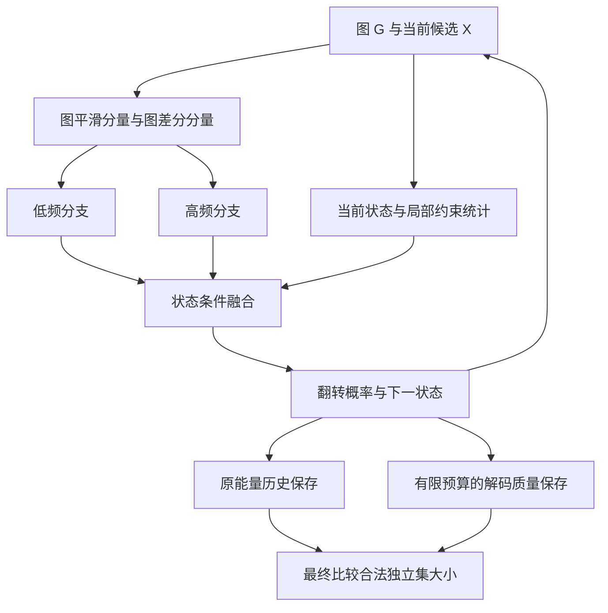

# RLNN / MIS 文献调研：高低频处理、因果解耦与解码一致的候选保存

**范围：2024—2026 年｜核查日期：2026-11-07（UTC）｜面向项目：RLNN_lab**

> 本文整理 **24 篇近期论文**：14 篇频率处理相关工作、10 篇因果与不变学习相关工作；另列 1 篇直接相关的 GCON 背景论文。每篇提供正式发表信息、论文下载入口、作者 GitHub 的核查结果、核心机制和迁移边界。
>
> **论文已提出的机制、针对 RLNN 的推导、尚待验证的研究建议，会分别说明。没有运行这些论文的训练，也没有宣称新模块一定提升 MIS 指标。**

## 阅读导航

- **只想知道该读哪几篇：** 先读第 1 节和第 9 节。
- **想下载论文、查看代码：** 查第 3、4、5 节的表格。
- **想判断三个“因果创新”是否成立：** 重点读第 6、7 节。
- **想确定下一步实验：** 读第 8 节。

---

## 1. 先给你结论

### 1.1 “高低频分开处理再融合”已经有充分先例

最接近你当前想法的，并不只有图像论文：

1. **GRACE，NeurIPS 2025（G1）**：已有低通专家、差分高通专家、节点门控，门控还使用邻居差异和度数相关信息。
2. **ICML 2026 的 GCON 任务迁移工作（G2）**：已经把多滤波器图网络用于 **MIS**，因此“图小波用于 MIS”也不能单独作为首次贡献。
3. **WaveGC、PolyGCL、LOHA（G3—G5）**：分别覆盖多尺度小波、可学习低高频滤波、分支之间的训练关系。
4. **FreqFusion、FADC、Wave-Mamba、F2Net（V1—V3、V5）**：在视觉任务中已经研究了分频处理、局部频带选择和跨频融合。

上面各项均有对应的正式论文与链接，详见后文。**“已有先例”不等于你不能做；它决定了你需要比现有结构多解释什么、多验证什么。**

较有价值的研究问题是：

> 在 RLNN 的动态二值候选状态中，哪些频率成分有助于判断加入、删除和冲突修复？能否根据当前状态与动作收益调节处理方式，并在相同总时间下得到更大的合法独立集？

这是一项需要验证的研究假设，目前还不是已证明的创新。

### 1.2 三个因果想法需要改写，不能按原说法直接落地

| 原设想 | 本次判断 | 建议保留的研究方向 |
|---|---|---|
| ① 净化由节点度数造成的虚假能量优势 | 当前能量本身不直接奖励高度数或冲突；历史候选也不是伪标签 | **解码一致的候选保存与收益预测** |
| ② 将决策与结构表示正交，得到因果解耦 | 双分支可以研究，但正交不等于独立，更不等于因果识别 | **动态状态与结构约束分工，再条件融合** |
| ③ 投影掉冲突密度，阻断后门 | 给出的箭头链是正向路径；冲突是必要约束信息，不能直接删掉 | **同图、同起点的成对动作干预与 rollout 评价** |

这不是否定三个方向，而是把它们变成有明确对象、可验证收益、不会混淆术语的研究问题。第 6 节给出代码与小图反例，第 7 节给出每个方向能借鉴的论文。

### 1.3 最建议你组合的两个模块

- **模块 A：动态状态条件下的图频率处理。** 发挥你在多分支、频域处理、融合和梯度分析上的经验。
- **模块 B：解码一致的候选保存。** 直接针对 RLNN 的保存准则与最终评价之间的错配。
- **因果方法先作为实验设计工具。** 用明确的动作替换与成对 rollout，检查模块究竟改变了什么。现阶段不要把“因果净化、因果解耦、因果干预”三个名称都写进模型贡献。

---

## 2. 文献筛选与等级口径

### 2.1 年份与 CCF 等级

本文按**正式发表年份**筛选 2024、2025、2026 年，不把预印本首次上传年份与会议年份混用。例如 F2Net 的 arXiv 首稿在 2025 年，正式论文按 **CVPR 2026** 记录。

CCF 等级统一采用 **2026 年第七版正式目录**。CCF 在 2026-03-31 发布新版，后续有勘误；本文使用高校官网保存的 CCF 原始目录 PDF。当前目录中的 AAAI、NeurIPS、ICML、ICLR、CVPR、ICCV、ACM MM 及 TPAMI 属于本文涉及的 A 类来源。**ICLR 现为 A；IJCAI 现为 B。不能混用旧网页和新目录。**

这里是按当前目录选文献，并非断言某会议在论文发表当年已经具有同一等级。CCF 目录没有另设通用的“A 以上”档位，本报告按 A 类处理。

来源：

- [CCF 官方目录公告](https://www.ccf.org.cn/Academic_Evaluation/By_category/)
- [高校官网转载说明](https://kyc.lsu.edu.cn/2026/0518/c1772a367789/page.htm)
- [第七版 CCF 正式目录 PDF](https://kyc.lsu.edu.cn/_upload/article/files/20/77/2cbaa3754eb9aff9ed74cafed8ff/23a8de02-594c-445f-b084-69b0193c05b3.pdf)

只把正式主会论文纳入相应会议等级；预印本、Workshop 与名称相近的会议不自动继承主会等级。

### 2.2 “SCI 一区”采用什么定义

“SCI 一区”可能指 JCR Q1，也可能指中科院一区，二者不同。本文的期刊筛选采用 **JCR Q1**。

CaUCD、DADR-HCD、CausalCD 均发表于 TGRS。本次可核验的一手证据是 IEEE GRSS 官方发布的 **2025 JCR 口径**：TGRS 在 Remote Sensing 类中为 **5/64、Q1**。本文据此纳入，但**不把它写成已核验的中科院一区，也不冒称已核验 2026 最新分区或各发表年的历史分区**。

来源：[IEEE GRSS 官方期刊指标公告](https://www.linkedin.com/posts/ieee-grss_tgrs-ieeegrss-journalmetrics-activity-7382747311015256065-UwJw)。

表格中的 **JCR Q1¹** 均指这个已核验口径。若你的考核要求明确是“中科院一区”，这三篇的资格需要按指定年度另外核对；其他 CCF A 主会论文不受这个分区歧义影响。

### 2.3 下载与代码状态

- **PDF**：提供官方论文集或作者公开稿。部分 AAAI 页面会触发访问校验，能找到作者稿时同时提供替代入口。
- **下载入口**：明确标识为页面时，需进入页面点击 PDF，可能要求机构权限；不冒充免登录直链。
- **公开源码**：已看到作者仓库及实现文件，不代表本次已成功复现。
- **部分实现 / 占位**：分别标明，不能当作完整可运行工程。
- **未找到**：表示本次没有核实到作者仓库，不断言作者永远不会公开。

本次是针对研究选题的定向调研，不声称穷尽 2024—2026 年所有相关文献。

---

## 3. 图频率方法：与你的 RLNN 最直接相关

### 3.1 下载与代码总表

表中 8 篇均按第 2 节口径属于 **CCF A**。其中 G1—G5 最值得优先阅读；G6—G8 提供相关分析或滤波设计，不能全部说成同一种低高频双分支结构。

| 编号 | 方法 / 发表 | 与当前想法的关系 | 论文下载 | 作者 GitHub / 状态 |
|---|---|---|---|---|
| G1 | **GRACE** · NeurIPS 2025 | 低通专家 + 差分高通专家 + 节点门控；最接近当前设想 | [PDF](https://proceedings.neurips.cc/paper_files/paper/2025/file/eb154abcbfa13d23f01ad3e091e92b08-Paper-Conference.pdf) | [GitHub](https://github.com/KEAML-JLU/GRACE)；公开源码；已读核心实现 |
| G2 | **GCON / 任务迁移** · ICML 2026 | 多滤波器图网络已经用于 MIS；任务最接近 | [PDF](https://raw.githubusercontent.com/mlresearch/v306/main/assets/canturk26a/canturk26a.pdf) | [GitHub](https://github.com/semihcanturk/COPT-MT)；公开源码；未运行复现 |
| G3 | **WaveGC** · ICML 2025 | scaling 分支 + 多尺度 wavelet 分支 + 融合 | [PDF](https://raw.githubusercontent.com/mlresearch/v267/main/assets/liu25y/liu25y.pdf) | [GitHub](https://github.com/liun-online/WaveGC)；公开作者源码 |
| G4 | **PolyGCL** · ICLR 2024 | 可学习低通/高通滤波 + 共享 MLP + 线性融合 | [PDF](https://proceedings.iclr.cc/paper_files/paper/2024/file/6faf3b8ed0df532c14d0fc009e451b6d-Paper-Conference.pdf) | [GitHub](https://github.com/ChenJY-Count/PolyGCL)；公开作者源码 |
| G5 | **LOHA** · AAAI 2025 | 低高频视图分别学习，处理分离与重聚合关系 | [PDF](https://arxiv.org/pdf/2501.02969) | 未核实到可用作者仓库 |
| G6 | **HeroFilter** · NeurIPS 2025 | 自适应谱滤波与 patch 混合；相关但不是固定双分支 | [PDF](https://proceedings.neurips.cc/paper_files/paper/2025/file/5d570ed1708bbe19cb60f7a7aff60575-Paper-Conference.pdf) | [GitHub](https://github.com/zshuai8/HeroFilter)；公开作者源码 |
| G7 | **WaveNet** · AAAI 2024 | Haar scaling 基函数参数化谱响应；补充参考 | [PDF](https://ojs.aaai.org/index.php/AAAI/article/download/28781/29496) | [GitHub](https://github.com/Bufordyang/WaveNet)；公开作者源码 |
| G8 | **KWGNN** · AAAI 2024 | 互补多频带核 + 原始分支 + 拼接融合 | [PDF](https://ojs.aaai.org/index.php/AAAI/article/download/27875/27775) | 未查到公开作者实现 |

### G1｜GRACE：Graph Few-Shot Learning via Adaptive Spectrum Experts and Cross-Set Distribution Calibration

[正式论文页](https://proceedings.neurips.cc/paper_files/paper/2025/hash/eb154abcbfa13d23f01ad3e091e92b08-Abstract-Conference.html)

**原任务：** 少样本节点分类。

**原论文怎么做：** 低通专家用 GCN；高通专家从投影后的原始特征减去低通表示，经过归一化与注意力；节点门控融合两个输出。门控已使用节点特征、邻居差异、邻域统计量和度数相关信息。

**迁移到 RLNN 的判断：** 可以学习局部条件门控，但“低高频双分支 + 差异/度数门控”本身已有先例。RLNN 应进一步研究同一节点在不同候选状态、搜索阶段和动作收益下的频带需求。

**需要注意：** 差分分支包含学习投影与非线性，不是严格正交分频，也不保证输入精确重构。作者高通注意力沿稀疏边实现。少样本分类的支持集/查询集校准不适合原样迁入 MIS。

**建议阅读位置：** 论文 Sec. 4.1；作者 models.py。

### G2｜GCON / 任务迁移：Can Computational Reducibility Lead to Transferable Models for Graph Combinatorial Optimization?

[正式论文页](https://proceedings.mlr.press/v306/canturk26a.html)

**原任务：** MIS、MVC、MaxClique 等组合优化及跨任务迁移。

**原论文怎么做：** 使用 GCON 编码器、基于目标函数的无监督能量损失与可行解解码，并研究不同组合优化任务之间的预训练和微调。GCON 使用低通传播组与不同尺度传播之差组成的小波组。

**迁移到 RLNN 的判断：** 应作为“图频率模块用于 MIS”的直接相关工作。可比较一阶残差分频、多尺度差分以及两组分别归一化的融合方式。

**需要注意：** 该求解器预测节点入选分数，输入含度数、聚类系数、三角形数；并非 RLNN 的当前二值状态到迭代翻转概率。不能不对齐数据、解码和预算就比较指标。PMLR 已有正式 ICML 2026 卷页，不能误记为仅有预印本。

**建议阅读位置：** 正式 PDF Sec. 3.1–3.3；再读下文 GCON 原论文背景。

### G3｜WaveGC：A General Graph Spectral Wavelet Convolution via Chebyshev Order Decomposition

[正式论文页](https://proceedings.mlr.press/v267/liu25y.html)

**原任务：** 一般图学习与长短程信息建模。

**原论文怎么做：** 分别组合 Chebyshev 多项式的奇、偶项，学习 scaling/wavelet 函数和尺度。各分支先变换、再进行通道处理和合成，最后拼接后用 MLP 融合。

**迁移到 RLNN 的判断：** 适合在最简单的一阶低高频模块有效之后，研究多尺度差分是否提供额外收益。可借鉴分支内处理与融合的顺序。

**需要注意：** scaling 与多尺度 wavelet 不等于互不重叠的硬低高频切分。谱分解、稠密变换和多尺度传播都有成本；不能只比较迭代步数。早期稿名 Advancing Graph Convolutional Networks via General Spectral Wavelets 是同一工作的旧题目。

**建议阅读位置：** 正式 PDF Sec. 3.1–3.3、Eq. 8–10。

### G4｜PolyGCL：PolyGCL: Graph Contrastive Learning via Learnable Spectral Polynomial Filters

[正式论文页](https://proceedings.iclr.cc/paper_files/paper/2024/hash/6faf3b8ed0df532c14d0fc009e451b6d-Abstract-Conference.html)

**原任务：** 自监督图表示学习、节点分类。

**原论文怎么做：** 利用可学习多项式构造两个谱视图，通过参数化控制滤波响应，再经共享 MLP 和线性组合得到表示；对比目标使表示利用两种频率信息。

**迁移到 RLNN 的判断：** 适合作为固定一阶滤波与可学习滤波的对照。首版可以只迁移滤波器，保留 RLNN 原训练目标。

**需要注意：** 原来的对比目标、打乱节点特征的负样本策略不应直接复制：改变二值状态会改变冲突与目标值。两个滤波器也不必满足精确互补重构。ICLR 的 A 类身份按 2026 目录判断。

**建议阅读位置：** 正式 PDF Sec. 4.1–4.2、Eq. 1–4。

### G5｜LOHA：LOHA: Direct Graph Spectral Contrastive Learning Between Low-Pass and High-Pass Views

[正式论文页](https://ojs.aaai.org/index.php/AAAI/article/view/33473) · [官方 PDF 备用](https://ojs.aaai.org/index.php/AAAI/article/download/33473/35628)

**原任务：** 自监督图表示学习、节点分类。

**原论文怎么做：** 学习低通、高通视图，经共享 MLP 和组合表示训练；在视图差异之外，还用 spectral signal trend 相关目标保留两个分支共同服务的节点信息。

**迁移到 RLNN 的判断：** 适合研究“分支应保留多少差异、又共享哪些任务信息”。先检查双分支是否重复或失衡，再考虑其辅助目标。

**需要注意：** 不能未经分析就把同一节点的高低频互当负样本。两路在 MIS 中服务于同一个翻转决策。第三方指向的 zoezzy0125/LOHA 在本次查询中返回 404，本文不把它列为已核验官方代码。

**建议阅读位置：** 作者全文的 Views Construction 与 Loss Design。

### G6｜HeroFilter：HeroFilter: Adaptive Spectral Graph Filter for Varying Heterophilic Relations

[正式论文页](https://proceedings.neurips.cc/paper_files/paper/2025/hash/5d570ed1708bbe19cb60f7a7aff60575-Abstract-Conference.html)

**原任务：** 不同异配程度下的图学习。

**原论文怎么做：** 学习谱滤波，用滤波后的相关性选择节点 patch，再沿 patch 维和特征维进行 MLP 混合；也提供避免完整特征分解的快速版本。

**迁移到 RLNN 的判断：** 用来检查动机是否过度简化：异配程度和频率响应不是一句“增强高频”就能概括的。频带使用应由任务状态验证。

**需要注意：** 这不是固定低通、高通两路后门控融合的同型方法。patch 选择与额外感受野会改变成本，不能把所有收益归给分频。

**建议阅读位置：** 正式 PDF 的频谱分析与 Sec. 4。

### G7｜WaveNet：WaveNet: Tackling Non-stationary Graph Signals via Graph Spectral Wavelets

[正式论文页](https://ojs.aaai.org/index.php/AAAI/article/view/28781)

**原任务：** 节点分类、非平稳图信号。

**原论文怎么做：** 使用多分辨率分析，以 Haar scaling 基函数重建图谱滤波响应和传播矩阵。

**迁移到 RLNN 的判断：** 可以参考另一种滤波器参数化方式，优先级低于 GRACE、WaveGC、PolyGCL。

**需要注意：** 不是语音生成的同名 WaveNet，也不是已经实现固定低高频门控的同型网络。不能将它对部分多项式方法的分析扩展为“所有多项式方法都无法拟合高频”。

**建议阅读位置：** 正式 PDF Sec. 3、Eq. 17。

### G8｜KWGNN：Kumaraswamy Wavelet for Heterophilic Scene Graph Generation

[正式论文页](https://ojs.aaai.org/index.php/AAAI/article/view/27875)

**原任务：** 场景图生成。

**原论文怎么做：** 用一组 Kumaraswamy 谱核覆盖不同频段，把频带输出与输入映射拼接，再由 MLP 融合，缓解场景图谓词特征被过度平滑的问题。

**迁移到 RLNN 的判断：** 与你的视觉背景相关，可学习多频带与原始分支共同融合的方式。

**需要注意：** 场景图谓词分类与 MIS 翻转决策不同；原文的异配语义不能直接成为 MIS 理论依据。更多核也会增加容量与传播次数。

**建议阅读位置：** 正式 PDF 的谱核设计与 Eq. 10。

### 3.2 GRACE 的代码迁移有一个具体问题

[作者核心代码 models.py](https://github.com/KEAML-JLU/GRACE/blob/main/models.py) 的 Gating.forward 在首次调用后缓存拼接特征；条件为 **self._x_cat is None**。缓存包含当前特征、邻居差分、邻域统计量等。

原任务可以使用固定图、固定输入特征。RLNN 的状态随搜索步骤和轨迹变化，所以迁移时必须：

1. 每次 forward 重新计算与当前状态有关的门控输入。
2. 只缓存图拓扑、静态度数等不会随状态变化的量。
3. 保留候选轨迹维度，不把第 1 条与第 2 条轨迹当作空间邻居。
4. 记录论文与代码的差异：论文描述绝对邻居差值，公开代码拼接有符号差值。

这是实现正确性要求，本身不是论文创新。

### 3.3 必须补读的背景：GCON 原论文

**Towards a General Recipe for Combinatorial Optimization With Multi-Filter GNNs**，Learning on Graphs，PMLR 269，**出版年 2025**。

- [正式论文页](https://proceedings.mlr.press/v269/wenkel25a.html)
- [官方 PDF](https://raw.githubusercontent.com/mlresearch/v269/main/assets/wenkel25a/wenkel25a.pdf)
- [作者 GitHub](https://github.com/WenkelF/copt)

**它不计入前面的 24 篇合格主清单。** Learning on Graphs 不能因为使用 PMLR 出版就被算成 ICML 或 CCF A；G2 才是正式 ICML 2026 工作。

其核心是低通传播组与尺度差分组，例如：

\[
P^kX,\qquad (P^{k_1}-P^{k_2})X.
\]

两组内部各自进行节点注意力归一化，再与原始残差合并。原文分析了某些条件下共享 softmax 可能让低通幅值压制差分响应的问题。因此，**“低高频分组归一化后融合”也有直接的组合优化先例**。

原论文采用的扩散矩阵写法是 \(P=(I+AD^{-1})/2\)。若你的实现用 \((I+D^{-1}A)/2\)，必须检查左右归一化、特征矩阵方向及对应谱定义，不能只复制公式名称。

---

## 4. 视觉频率方法：发挥你的已有经验

### 4.1 下载与代码总表

下面 6 篇均满足本文的 **CCF A** 筛选口径。它们支持“分频、分支处理与融合已有先例”，但不能替代 MIS 任务上的验证。

| 编号 | 方法 / 发表 | 核心参考点 | 论文下载 | 作者 GitHub / 状态 |
|---|---|---|---|---|
| V1 | **FreqFusion** · IEEE TPAMI 2024 | 自适应低通、细节补偿与融合 | [PDF](https://arxiv.org/pdf/2408.12879) | [GitHub](https://github.com/Linwei-Chen/FreqFusion)；有公开实现，未运行复现 |
| V2 | **FADC** · CVPR 2024 | 局部频带选择、频率自适应卷积 | [PDF](https://arxiv.org/pdf/2403.05369) | [GitHub](https://github.com/Linwei-Chen/FADC)；有公开实现，未运行复现 |
| V3 | **Wave-Mamba** · ACM Multimedia 2024 | 低频状态空间建模、高频引导 | [PDF](https://arxiv.org/pdf/2408.01276) | [GitHub](https://github.com/AlexZou14/Wave-Mamba)；有公开实现，未运行复现 |
| V4 | **FDConv** · CVPR 2025 | 卷积权重的频率参数化 | [PDF](https://arxiv.org/pdf/2503.18783) | [GitHub](https://github.com/Linwei-Chen/FDConv)；有公开实现，未运行复现 |
| V5 | **F2Net** · CVPR 2026 | 高低频分支、混合融合与训练协调 | [PDF](https://openaccess.thecvf.com/content/CVPR2026/papers/Chen_F2Net_A_Frequency-Fused_Network_for_Ultra-High_Resolution_Remote_Sensing_Segmentation_CVPR_2026_paper.pdf) | [GitHub](https://github.com/easm002/F2Net)；有公开实现，未运行复现 |
| V6 | **HDW-SR** · CVPR 2026 | 小波分解、跨频引导与扩散 | [PDF](https://arxiv.org/pdf/2511.13175) | [GitHub](https://github.com/Baty2023/HDW-SR)；完整代码/权重尚未全部公开 |

### V1｜FreqFusion：Frequency-aware Feature Fusion for Dense Image Prediction

[正式论文页 / DOI](https://doi.org/10.1109/TPAMI.2024.3449959)

**原论文怎么做：** 对高层粗特征生成自适应低通滤波，减少类别内部不一致；用偏移重采样修正特征位置；对较浅层高分辨率特征补充高频细节。

**迁移到 RLNN 的判断：** 可借鉴两路职责不同、分别变换后融合的思路。但原方法围绕二维上采样和边界恢复，不能把它的滤波核或偏移采样直接用于无序图节点。

**对新颖性的影响：** 足以证明“低频负责平滑一致性、高频补细节并融合”已有先例。MIS 中两路的职责需要重新通过状态与收益分析定义。

### V2｜FADC：Frequency-Adaptive Dilated Convolution for Semantic Segmentation

[正式论文页 / DOI](https://openaccess.thecvf.com/content/CVPR2024/html/Chen_Frequency-Adaptive_Dilated_Convolution_for_Semantic_Segmentation_CVPR_2024_paper.html)

**原论文怎么做：** AdaDR 根据局部频率调整膨胀率；AdaKern 分离卷积权重低高频并调比例；FreqSelect 对特征频带进行空间位置相关的重加权。

**迁移到 RLNN 的判断：** 最适合借鉴 FreqSelect 的局部频带选择，而不是复制二维可变膨胀卷积。图上应改成根据局部搜索状态选择图滤波分量或传播阶数。

**对新颖性的影响：** “频带权重随位置变化”已经存在；候选贡献需来自搜索状态、动作收益及图约束。

### V3｜Wave-Mamba：Wave-Mamba: Wavelet State Space Model for Ultra-High-Definition Low-Light Image Enhancement

[正式论文页 / DOI](https://doi.org/10.1145/3664647.3681580)

**原论文怎么做：** 低频支路用状态空间模块建模较大范围的信息，高频支路利用增强后的低频引导细节恢复，通过小波结构组合。

**迁移到 RLNN 的判断：** 可以借鉴两路采用不同计算预算及跨频引导。但图上的高频不等于图像噪声，不能照搬该文在低照增强场景得到的频率重要性结论。

**对新颖性的影响：** 不同频率使用不同模块与跨频引导，也不是新的通用结构。此文与 ICCV 2025 的 RGB-IR WaveMamba 是不同论文。

### V4｜FDConv：Frequency Dynamic Convolution for Dense Image Prediction

[正式论文页 / DOI](https://openaccess.thecvf.com/content/CVPR2025/html/Chen_Frequency_Dynamic_Convolution_for_Dense_Image_Prediction_CVPR_2025_paper.html)

**原论文怎么做：** 在傅里叶域分组学习具有不同频率响应的卷积权重，再通过空间与频带调制适配输入。

**迁移到 RLNN 的判断：** 可借鉴“让滤波器具有不同谱响应，再按输入调制”。但它主要研究卷积权重的频率参数化，不等于直接把 RLNN 状态分成低高频。

**对新颖性的影响：** 适合作为可学习滤波方向参考，相关度低于直接图低高频方法，不优先作为首版实现。

### V5｜F2Net：F2Net: A Frequency-Fused Network for Ultra-High Resolution Remote Sensing Segmentation

[正式论文页 / DOI](https://openaccess.thecvf.com/content/CVPR2026/html/Chen_F2Net_A_Frequency-Fused_Network_for_Ultra-High_Resolution_Remote_Sensing_Segmentation_CVPR_2026_paper.html) · [作者 PDF 备用](https://arxiv.org/pdf/2506.07847)

**原论文怎么做：** 高频支路保留全分辨率结构，低频支路在降采样后分别处理短程和长程信息；Hybrid-Frequency Fusion 融合，并用跨频对齐与梯度平衡目标协调训练。

**迁移到 RLNN 的判断：** 与你熟悉的分支网络和编码器—解码器设计接近。可借鉴分支职责、融合和分支梯度诊断；MIS 没有像素语义标签，不能直接照搬跨频语义对齐损失，也不应先把高低频强行对齐。

**对新颖性的影响：** “低高频分支+融合+分支训练协调”已有 2026 年正式先例。其 arXiv 首稿是 2025 年，本文按 CVPR 正式年份记为 2026。

### V6｜HDW-SR：HDW-SR: High-Frequency Guided Diffusion Model based on Wavelet Decomposition for Image Super-Resolution

[正式论文页 / DOI](https://openaccess.thecvf.com/content/CVPR2026/html/Yang_HDW-SR_High-Frequency_Guided_Diffusion_Model_based_on_Wavelet_Decomposition_for_CVPR_2026_paper.html)

**原论文怎么做：** 使用小波下采样和重建，在残差扩散中用高频子带与低频子带的稀疏交叉注意力进行引导，并以动态阈值选择高频。

**迁移到 RLNN 的判断：** 可借鉴跨频信息交互与按内容选择高频的思路。RLNN 不是图像扩散模型，没有该文的预超分图像条件，不应直接复用其目标或 U-Net。

**对新颖性的影响：** 属于高低频交互的补充参考，不是与 RLNN 最接近的结构对照。

**代码状态：** 作者仓库已公开，但 README 明示权重以及完整训练/推理代码尚未全部公开。

### 4.2 视觉经验可以迁移，但张量语义不能混淆

RLNN 的输入 \([N,20,1]\) 是一个三阶张量：节点数 × 并行候选轨迹数 × 每节点特征通道。它不是具有二维空间邻接关系的图像特征图。

你的优势可以用于**分支设计、不同频带的计算分配、残差融合、梯度诊断和消融分析**。具体运算要改为沿图邻接关系定义的算子，而不能对节点编号和轨迹编号组成的“矩形”直接做二维 FFT 或小波。

---

## 5. 三个因果方向的相关文献

### 5.1 下载、代码和对应方向总表

① 表示候选/监督目标质量；② 表示解耦与不变学习；③ 表示干预或去混杂。表格中的“对应”表示可借鉴的研究思路，不代表论文已经证明了 RLNN 中的相同问题。

| 编号 | 方法 / 正式发表 / 等级 | 对应方向 | 论文下载或获取入口 | 作者 GitHub / 状态 |
|---|---|---|---|---|
| C1 | **CaUCD** · IEEE TGRS 2026 · JCR Q1¹ | ① 候选目标质量；③ 去混杂思想 | [IEEE 下载入口；未取得公开全文](https://ieeexplore.ieee.org/abstract/document/11556470) | [GitHub](https://github.com/zhangshao249/CaUCD)；有训练、分割和测试源码；未运行 |
| C2 | **DADR-HCD** · IEEE TGRS 2024 · JCR Q1¹ | ② 内容/风格解耦 | [IEEE 下载入口；未找到公开作者全文](https://ieeexplore.ieee.org/abstract/document/10535904) | 未核验到官方仓库 |
| C3 | **CausalCD** · IEEE TGRS 2024 · JCR Q1¹ | ① 伪标签自训练；③ 后门调整 | [作者全文 / PDF 下载页](https://www.researchgate.net/publication/382286303_CausalCD_A_Causal_Graph_Contrastive_Learning_Framework_for_Self-Supervised_SAR_Image_Change_Detection) | [GitHub](https://github.com/yikuaixigua/CausalCD)；有部分实现；完整训练链路未确认 |
| C4 | **GCIL** · AAAI 2024 · CCF A | ② 独立性；③ 谱增强与不变性 | [PDF](https://arxiv.org/pdf/2401.12564) | [GitHub](https://github.com/BUPT-GAMMA/GCIL)；公开作者源码 |
| C5 | **ICL** · AAAI 2024 · CCF A | ② 图表征解耦 | [PDF](https://ojs.aaai.org/index.php/AAAI/article/download/29648/31102) | [GitHub](https://github.com/DataLab-atom/ICL)；有模型与训练源码 |
| C6 | **CIA / CIA-LRA** · NeurIPS 2024 · CCF A | ② 不变性失效分析 | [PDF](https://proceedings.neurips.cc/paper_files/paper/2024/file/932147114c48f8b04d41aebc0c631158-Paper-Conference.pdf) | [GitHub](https://github.com/NOVAglow646/NeurIPS24-Invariant-Learning-on-Graphs)；公开作者源码 |
| C7 | **CIA-GCL** · ICML 2025 · CCF A | ② 子图分离；③ 不变性增强 | [PDF](https://raw.githubusercontent.com/mlresearch/v267/main/assets/yu25o/yu25o.pdf) | [GitHub](https://github.com/qinsheng1900/CIA-GCL)；有实际模型和训练源码 |
| C8 | **CGR** · ICML 2025 · CCF A | ②、③ 如何处理仍有预测价值的因素 | [PDF](https://raw.githubusercontent.com/mlresearch/v267/main/assets/yin25d/yin25d.pdf) | [GitHub](https://github.com/causal-graph/CGR)；公开作者源码 |
| C9 | **IDG** · NeurIPS 2025 · CCF A | ② 无环境标签的不变性 | [PDF](https://papers.nips.cc/paper_files/paper/2025/file/69e9bb0cb58d65f26d58c4c620ba22a1-Paper-Conference.pdf) | [GitHub](https://github.com/anders1123/IDG)；仅 README 占位，尚无实现 |
| C10 | **CDDGNet** · AAAI 2026 · CCF A | ② 解耦；频域 + 编码/解码融合 | [PDF](https://ojs.aaai.org/index.php/AAAI/article/download/38314/42276) | [GitHub](https://github.com/M2WindRunner/CDDGNet)；有训练/评估源码；未运行 |

¹ TGRS 的 Q1 按第 2.2 节的已核验 JCR 2025 口径，不等于中科院一区。

### C1｜CaUCD：CaUCD: Causal Unsupervised Change Detection

[正式论文页](https://ieeexplore.ieee.org/abstract/document/11556470) · [DOI](https://doi.org/10.1109/TGRS.2026.3702032)

**原论文怎么做：** 先由 CUSeg 生成伪标签、降低上下文干扰，再由 C2D 处理不同地物类别对变化预测的影响。正式出版日期为 2026-06-09。

**可以迁移什么：** 可借鉴先审查监督目标的形成、再检查网络如何使用它。但 RLNN 的历史候选不是伪标签；只有在候选被转成训练目标时，才出现相应的监督链路。

**不能直接推出什么：** 本次未取得可公开读取的完整 PDF，无法逐式核验；本报告不声称验证了全部因果推导。也没有证据支持简单加入节点度数惩罚就等于其方法。

**本次阅读范围：** IEEE 正式摘要、作者 README 与源码文件树；完整 PDF 未取得。

### C2｜DADR-HCD：DADR-HCD: A Deep Domain Adaptation and Disentangled Representation Network for Unsupervised Heterogeneous Change Detection

[正式论文页](https://ieeexplore.ieee.org/abstract/document/10535904) · [DOI](https://doi.org/10.1109/TGRS.2024.3403727)

**原论文怎么做：** 通过显式图像翻译，把双时相异质图像的内容特征与风格特征分开；推理时根据内容特征相似性计算变化概率。

**可以迁移什么：** 可以借鉴分支分工与辅助目标的设计。RLNN 可区分动态状态信息和静态结构信息，但二者都可能与动作收益有关。

**不能直接推出什么：** 图结构决定 MIS 可行域，不能对应成应当删除的成像风格。仅凭摘要不能认定原文使用了某个具体正交损失。

**本次阅读范围：** IEEE 正式摘要；未获得公开全文或作者代码。

### C3｜CausalCD：CausalCD: A Causal Graph Contrastive Learning Framework for Self-Supervised SAR Image Change Detection

[正式论文页](https://doi.org/10.1109/TGRS.2024.3427848)

**原论文怎么做：** 在图对比学习和伪标签自训练链路上建模偏差。方法部分使用 PCA 与 K-means++ 形成混杂原型，通过注意力和 NWGM 近似调整，再将调整特征与图表征拼接，用交叉熵训练。

**可以迁移什么：** 可参考如何明确变量、偏差路径和近似调整对象。若在 RLNN 中借鉴原型机制，应先定义原型对应什么状态条件、如何产生辅助目标。

**不能直接推出什么：** 原文不是“将局部冲突密度从特征中投影出去”。作者全文页可读，自动取得 PDF 按钮直链失败，故提供下载页面。仓库有原型、微调和预测代码，但 README 仍提示完整代码待公开。

**本次阅读范围：** 作者 Jiang Qin 上传的全文，重点核验 IV-D3 与 Eq. 19–23；并核查仓库。

### C4｜GCIL：Graph Contrastive Invariant Learning from the Causal Perspective

[正式论文页](https://ojs.aaai.org/index.php/AAAI/article/view/28738) · [官方 PDF 备用](https://ojs.aaai.org/index.php/AAAI/article/download/28738/29423)

**原论文怎么做：** 用谱增强构造视图，再结合跨视图不变性目标和基于 HSIC 等的维度独立性目标。原文把低频近似视为不变内容，对高频施加更强变化。

**可以迁移什么：** 它连接频域与因果视角，适合学习怎样把假设拆成增强、对齐、独立性三个可消融组件。

**不能直接推出什么：** “低频是因果内容、高频是非因果因素”是原任务的假设，不能作为 MIS 的结论。原图加删边会改变 MIS 可行域，不能默认为保持任务不变的增强。

**本次阅读范围：** 作者全文的方法部分与官方仓库。

### C5｜ICL：A Twist for Graph Classification: Optimizing Causal Information Flow in Graph Neural Networks

[正式论文页](https://ojs.aaai.org/index.php/AAAI/article/view/29648)

**原论文怎么做：** 提出解耦层和多目标互信息目标，用变分界得到可优化损失，再用多目标梯度下降协调训练。

**可以迁移什么：** 可以学习如何让两个分支各有约束，以及如何避免辅助目标与主目标发生梯度冲突。

**不能直接推出什么：** 原任务有分类标签。RLNN 的主目标是组合能量，辅助监督必须重新定义；不能只加入一个正交正则，就声称复现了该论文的因果解耦，其互信息目标和多目标优化机制也需要对应设计。

**本次阅读范围：** 正式摘要、官方 PDF 入口及作者代码；自动全文下载受限。

### C6｜CIA / CIA-LRA：Dissecting the Failure of Invariant Learning on Graphs

[正式论文页](https://proceedings.neurips.cc/paper_files/paper/2024/hash/932147114c48f8b04d41aebc0c631158-Abstract.html)

**原论文怎么做：** 分析消息传递为何妨碍简单不变学习；提出跨环境的同类表示对齐，以及利用邻居标签分布局部重加权的 CIA-LRA。

**可以迁移什么：** 提醒我们按条件讨论不变性，不能强制所有节点、所有状态共享同一种表示关系。

**不能直接推出什么：** 它的对齐依赖分类语义。MIS 中节点的加入、删除与保持依赖当前状态，不是固定节点类别，不能人为固定标签后直接套用。

**本次阅读范围：** 正式摘要、官方论文与作者代码入口；本文采用其方法概述，不复述全部证明。

### C7｜CIA-GCL：Causal Invariance-aware Augmentation for Brain Graph Contrastive Learning

[正式论文页](https://proceedings.mlr.press/v267/yu25o.html)

**原论文怎么做：** 学习与标签相关的不变子图，围绕它构造增强，以因果、不变性和对比目标训练脑图分类模型。

**可以迁移什么：** 可借鉴“先定义需要保留的信息，再设计允许变化的部分”。要同时说明保持什么目标以及变化是否真的无关。

**不能直接推出什么：** Eq. 13 的正交项约束两个增强表示；不变/混杂子图的分离主要通过互信息目标。不能将其误引为“决策通道与结构通道正交”。脑图分类的删边假设不能直接用于 MIS。

**本次阅读范围：** 已下载正式 PDF，核对 Sec. 3.5、Eq. 13 与代码。

### C8｜CGR：A Recipe for Causal Graph Regression: Confounding Effects Revisited

[正式论文页](https://proceedings.mlr.press/v267/yin25d.html) · [作者 PDF 备用](https://arxiv.org/pdf/2507.00440)

**原论文怎么做：** 重新讨论图回归中的混杂成分及其预测价值，通过信息瓶颈、表示重组与对比训练调整因果图学习方法。

**可以迁移什么：** 最值得用于检查“某类信息是否真应该删除”。在 MIS 中，度数与冲突都有任务意义，先保留并衡量作用更有依据。

**不能直接推出什么：** 作者在其假设下进行表示重组，并不意味着任意向量相减都构成有效干预。其图回归结论也不直接证明某个 MIS 模块有效。

**本次阅读范围：** 正式论文页、作者全文方法与官方代码。

### C9｜IDG：Quantifying Distributional Invariance in Causal Subgraph for IRM-Free Graph Generalization

[正式论文页](https://papers.nips.cc/paper_files/paper/2025/hash/69e9bb0cb58d65f26d58c4c620ba22a1-Abstract-Conference.html)

**原论文怎么做：** 提出不变分布判据，利用表示范数相关目标寻找因果子图，减少对显式环境标签和 IRM 环境划分的依赖。

**可以迁移什么：** 适合作为“不用外部环境标签，如何设置可测的不变性指标”的参考。

**不能直接推出什么：** 分布变化小不自动证明 MIS 子图具有因果意义。仓库在本次核查中只有 README，并写明代码将公开；论文中的 code available 不能替代实际文件检查。

**本次阅读范围：** 正式摘要与 PDF、作者仓库文件树；重点确认代码状态。

### C10｜CDDGNet：Causal Decoupling Domain Generalization for Remote Sensing Change Detection

[正式论文页](https://ojs.aaai.org/index.php/AAAI/article/view/38314)

**原论文怎么做：** 编码端结合小波和特征能量谱进行初步解耦，解码端通过频域处理与重新注意进行融合，并引入解耦效果损失。

**可以迁移什么：** 最贴近你的视觉经验，可学习阶段分工、跨频交互和消融组织方式。

**不能直接推出什么：** 二维小波不能直接作用于无序节点和候选轨迹轴。作者 README 提示预训练和超参数依赖，且重构实现与论文权重可能有差异。

**本次阅读范围：** AAAI 正式记录、可检索 PDF 摘要及作者代码；未逐式核验全文。

---

## 6. 对三个创新设想的代码与理论核查

本节核验对象是 RLNN_lab 的固定提交 **36df421aaa239f60aa860fe347310eb227734a71**，避免把不同版本的解码行为混在一起。

- [MIS 能量与两种解码器：models/problems/mis.py](https://github.com/YuqiWang-code/RLNN_lab/blob/36df421aaa239f60aa860fe347310eb227734a71/models/problems/mis.py)
- [训练、搜索与历史保存：models/solvers.py](https://github.com/YuqiWang-code/RLNN_lab/blob/36df421aaa239f60aa860fe347310eb227734a71/models/solvers.py)
- [默认参数与原生入口：models/main.py](https://github.com/YuqiWang-code/RLNN_lab/blob/36df421aaa239f60aa860fe347310eb227734a71/models/main.py)

### 6.1 当前能量是什么，为什么不能说它在奖励冲突

对无向、无自环图，记：

- \(x_i\in\{0,1\}\)：节点是否选中。
- \(S_x=\{i:x_i=1\}\)：已选节点集合。
- \(C(x)=\sum_{(i,j)\in E}x_ix_j\)：冲突边数，每条无向边只计算一次。
- \(\beta=1.02\)：当前默认惩罚系数。

代码的双向边权重各为 \(1/2\)，所以能量可以准确写为：

\[
E(x)=\beta C(x)-|S_x|.
\]

越低越好。若已选节点 \(i\) 有 \(n_i(x)\ge 1\) 个已选邻居，删除它的能量变化是：

\[
E(x-e_i)-E(x)=1-\beta n_i(x)\le -0.02<0.
\]

**因此，任何存在冲突的二值状态都有严格降能量的删除操作。** 精确全局最小值必然可行，并对应最大独立集。

这不代表有限步搜索总能找到全局最优，也不代表所有候选的能量排序与解码后排序一致。它只排除了一个不准确的动机：

> 不能把问题直接写成“目标函数通过奖励高度数或保留冲突，天然制造虚假最优”。

高度数并不直接出现在奖励项中；真正进入冲突惩罚的是**当前已选邻居数**。某个大而有冲突的集合可能比另一个很小的集合能量低，但这本身不足以证明“混杂造成了虚假优势”。

### 6.2 真正成立的问题：原能量与解码结果可能排序相反

使用同一张五节点路径图，边集合为：

\[
E=\{(1,2),(2,3),(3,4),(4,5)\}.
\]

比较下面两个状态：

| 候选 | 初始已选节点 | 冲突数 | 已选节点的度数 | 原能量 | 贪心解码后集合 | 最终大小 |
|---|---|---:|---|---:|---|---:|
| \(x=(0,1,0,1,0)\) | \(\{2,4\}\) | 0 | 均为 2 | \(-2\) | \(\{2,4\}\) | 2 |
| \(y=(0,0,1,0,0)\) | \(\{3\}\) | 0 | 为 2 | \(-1\) | \(\{1,3,5\}\) | 3 |

也就是：

\[
E(x)<E(y),\qquad |\mathcal D(x)|<|\mathcal D(y)|.
\]

解释很直接：

- \(x\) 已经是**极大独立集**：不能再直接加入任何节点，但大小只有 2。
- \(y\) 还能加入节点 1、5，解码后大小为 3。
- **极大**表示无法直接扩展，**最大**表示大小达到全图最优，二者不同。
- 两个候选都没有冲突，而且已选节点度数相同。因此，这个排序错配不需要用“冲突污染”或“度数混杂”解释。

若同一条轨迹先遇到 \(x\)，再遇到 \(y\)，当前按原始能量保存的规则不会用 \(y\) 替换 \(x\)，尽管 \(y\) 的最终解码结果更好。

这个反例也提醒我们：只按“初始选中更多、冲突更少”做 Pareto 保存仍可能漏掉好候选，因为这里 \(x\) 已经在这两个量上支配 \(y\)。

**这证明错配可能存在，不证明它在你的测试集上普遍或严重。** 下一步必须量化实际轨迹中的错配频率和可追回收益。

### 6.3 两种解码器都要区分清楚

当前固定版本包含两种实现：

| 解码方式 | 行为 | 上述反例是否成立 |
|---|---|---|
| 原贪心解码 | 按候选值从高到低选节点并屏蔽邻居；会继续加入原来为 0 的可用节点 | 成立 |
| 新增 gradient-flip | 逐次选择严格降低能量的单节点翻转，直到不能改进 | 成立 |

原生入口默认仍调用贪心解码；solver 支持显式传入解码回调，其他实验脚本可能选择 gradient-flip。**比较实验必须固定实际使用的解码器，不能把更换解码器产生的提升算到频率模块。**

上述小图的两种过程均用与代码规则等价的计算核对；不是训练结果，也不是完整 PyTorch 复现实验。

### 6.4 “伪标签”必须有监督语义

RLNN 的当前二值候选 \(x_t\) 是搜索状态；历史最优是缓存中的状态。在当前被核验的训练/推理链路中，这二者不因为“由网络生成”就自动成为伪标签。

只有明确引入下列过程时，才需要讨论辅助监督目标：

\[
(G,x_t)\longrightarrow \text{解码或 rollout 结果}
\longrightarrow \text{训练评分器/策略的目标}.
\]

例如，用真实解码大小训练候选评分器，可以叫**解码收益监督**。它不是未知真实类别的估计，不需要强行沿用变化检测里的“噪声伪标签”叙事。

### 6.5 节点度数与冲突密度，不自动是混杂因子

“混杂因子”必须相对于明确的处理变量与结果变量来定义。先说明：

- 你干预什么：单节点翻转、某个门控、某个策略模块，还是整个策略？
- 你评价什么：一步能量变化、\(H\) 步后的合法大小，还是整条轨迹的最好结果？
- 哪个因素同时影响处理分配与结果？相应的结构方程是什么？

原设想中的：

\[
\text{冲突密度}\rightarrow\text{翻转概率}
\rightarrow\text{搜索轨迹}\rightarrow\text{解码结果}
\]

是一条**正向作用路径**，不是后门路径。相对于动作 \(A\)，类似 \(A\leftarrow C\rightarrow Y\) 的路径才具有进入处理变量的方向；是否真的存在、如何调整，还需要相应假设。

RLNN 的度数是图的函数，冲突是图与状态的函数：

\[
d=f(G),\qquad C_t=C(G,x_t).
\]

它们可计算，而且可能是决策必须使用的信息。“会影响很多变量”不足以确认它们是需要删除的混杂因素。因果术语的基础定义可参见 [Pearl 的因果推断综述](https://ftp.cs.ucla.edu/pub/stat_ser/r350.pdf)；这只是术语参考，不计入近期文献清单。

### 6.6 正交不等于独立，投影不等于因果干预

设 \(Z\) 在 \([-1,1]\) 上均匀分布，令 \(W=Z^2-1/3\)。二者协方差为 0，但 \(W\) 完全由 \(Z\) 决定。

因此：

- 内积或协方差约束，可以减少某种几何或二阶相关性。
- 这不自动保证统计独立。
- 统计独立本身也不自动识别因果变量。
- 从表示中减去一个方向，是表示变换；仅凭该操作不能宣称完成 do 干预或后门调整。

此外，冲突信息直接影响单点翻转收益。删除一个没有已选邻居的已选节点，能量增加 1；删除一个有已选邻居的节点，能量可能降低。网络需要区分这两种状态。

所以，**先保留冲突信息并测量它的作用，比直接投影删除更有依据**。

---

## 7. 三个方向分别应该怎样改，文献怎么用

### 7.1 方向一：从“因果净化”改为“解码一致的候选保存”

**准确的问题：** 按原始能量筛选历史候选，可能漏掉解码后更好的结果。

**相关文献：**

- C1 CaUCD、C3 CausalCD：启发我们检查候选监督信号的形成过程，但并未研究 RLNN 历史缓存。
- G2：提供神经组合优化、能量目标与可行解解码的直接背景。
- 本文第 6.2 节的反例：直接支撑候选排序错配。

**建议先做诊断，不急着设计网络。**

冻结策略，在相同图、相同初始状态和相同随机数下保存候选轨迹。记：

时间索引包含初始状态；若能量并列最小，取首次出现的候选，与代码的严格小于更新规则一致。

\[
t_k^*=\arg\min_t E(x_{k,t}),
\]

\[
Y_{\mathrm{base}}
=\max_k |\mathcal D(x_{k,t_k^*})|,
\qquad
Y_{\mathrm{all}}
=\max_{k,t}|\mathcal D(x_{k,t})|.
\]

定义：

\[
\mathrm{ArchiveGap}=Y_{\mathrm{all}}-Y_{\mathrm{base}}.
\]

在同一候选集合上，该差值非负。这来自候选集合的包含关系，不是因果识别结论。全历史解码用于小规模离线诊断；若只抽样解码，样本必须包含 baseline 最终保存的候选，才能保持上述非负关系。抽样结果只能反映该样本中的可追回收益，不能冒称完整上限。

**第一版在线方法：**

1. 保留原来的按能量保存结果。
2. 每隔 \(r\) 步，在额外解码预算内评价一批候选。
3. 建立按合法独立集大小保存的记录。
4. 结束时同时比较原能量候选与额外合法候选，输出更好的结果。

当前两个解码函数只返回负的独立集大小。若要保存、输出或重用合法节点集合，需要扩展返回接口；不能把解码前的原状态直接标成合法解。

在**完全相同轨迹**上，增加候选并保留原结果可以保证最终选择不劣；在**固定总时间**下，额外解码可能挤占搜索步数，这个保证就不能直接使用。

**如果诊断显示错配明显，再训练轻量评分器：**

\[
s_\phi(G,x_t)\approx |\mathcal D(x_t)|
\]

或预测有限步 rollout 后的合法收益。训练目标来自训练图上的实际结果，测试图不参与拟合。评价评分器的候选排序、top-k 命中和最终解质量。

**工程可行性：较高。因果主张：目前不成立。新颖性：仍需与朴素多候选保存和解码优先方案比较。**

仅改变最终缓存，通常不会改变当前状态的搜索轨迹；它改善的是最终选取。若要让 archive 反过来引导重启或搜索，需要明确作为另外一个改动评价。

### 7.2 方向二：从“结构去因果化”改为“状态与约束的条件分工”

**准确的问题：** 单一路径可能难以同时处理当前选择差异、局部约束与结构范围信息。这个能力不足需要实验确认。

**优先参考：** G1 GRACE、G4 PolyGCL、C5 ICL、C7 CIA-GCL、C8 CGR。C2 DADR-HCD 和 C10 CDDGNet 可提供视觉解耦的设计经验。

建议使用两个功能清楚的分支：

| 分支 | 输入示例 | 希望承担的作用 |
|---|---|---|
| 动态状态分支 | 当前 \(x_i\)、图差分分量、近期翻转状态 | 表达当前候选的选择差异和变化 |
| 结构约束分支 | 度数、已选邻居数、局部平滑分量 | 表达冲突约束与周围选择情况 |

融合时允许模型使用两类信息。**不要规定“结构分支只能编码无关因素”**，也不要规定“动态分支必须与全部结构信息独立”。

若加入正交或 HSIC 类正则，应把它定位为减少冗余的可选正则，并做下列对照：

- 相同输入的单分支。
- 双分支，不加正则。
- 双分支，加正则。
- 双分支，加状态门控。
- 双分支，门控与正则同时使用。

如果正则没有稳定收益，就删除它，不为保持“因果”名称而保留。C7 的正交项约束两个增强表示，也提醒我们必须明确“究竟约束谁”。

**工程可行性：较高。表示分工可以检验；因果独立性暂时不能由结构设计保证。**

### 7.3 方向三：从“抹掉冲突”改为“成对动作干预”

**准确的问题：** 一步能量变化和有限步后的最终合法收益可能不一致。我们需要知道某个动作或某个频率分支是否实际带来收益。

**相关文献：** C3 提供如何明确调整对象的案例；C4、C6、C7 讨论不变性及增强的假设；C8 提醒我们不要一概删除有预测价值的因素。这些文献提供方法论参考，不直接给出 MIS 的识别保证。

对同一图 \(G\) 和同一起点 \(x_t\)，选一个动作对象，例如节点 \(i\)：

- 处理组：强制该节点在这一步翻转。
- 对照组：强制该节点在这一步不翻转。
- 其他节点本步的动作保持相同；之后继续使用同一冻结策略。
- 两组使用相同长度 \(H\)、相同解码规则及预先对齐的随机数。

记 \(\omega\) 为共享的后续随机数，则比较：

\[
\Delta U_H=
|\mathcal D(X_{t+H}^{do(A_i=1),\omega})|
-
|\mathcal D(X_{t+H}^{do(A_i=0),\omega})|.
\]

这里 \(A_i\) 表示“是否翻转”，不是翻转后的节点值。

**为什么这比直接投影更明确：** 被改变的变量、保持固定的条件、结果指标都能写清楚，也能直接运行两次求解过程进行比较。它估计的是特定起点与指定后续策略下的算法干预收益。

只设置同一个 seed 不一定够：如果分支消耗随机数的顺序不同，就失去配对。可预生成按步骤、节点、轨迹索引的随机数，两组按相同索引取用。

**可用这种实验回答：**

评估频率分支时，应把处理变量改为分支开关 \(Z\)，比较 \(do(Z=1)\) 与 \(do(Z=0)\)，并明确开关只作用于当前一步还是整个后续 \(H\) 步。节点翻转收益与分支收益是两个不同的干预目标，不能直接混用。

- 高频分支开启与关闭，在哪些状态产生正收益？
- 低频分支是否帮助减少后续冲突，或促进后续扩展？
- 当前能量改善最大的动作，是否总是有限步收益最大的动作？
- 某个结构统计量在不同状态中是有益、无效，还是有害？

这也可用于训练收益预测器，但会增加数据生成成本。先在训练/验证图的小样本上诊断，不必为每个节点、每个搜索步都运行双分支 rollout。

**工程可行性：中等，主要成本在采样与 rollout。算法干预对象明确；不能仅凭收益提升就声称已消除隐藏混杂。**

---

## 8. 推荐你实际推进的两模块方案

下面是基于文献与代码分析提出的研究方案，尚未经过模型实验。优先用少量改动检验关键假设。

### 8.1 模块 A：动态候选状态下的图频率处理

第一版采用轻量的互补滤波，不必先做完整特征分解。设 \(A_0\) 是无权邻接矩阵，\(D\) 是度矩阵。对非孤立节点定义：

\[
P=\frac12(I+D^{-1}A_0),
\qquad X_L=PX,\qquad X_H=(I-P)X.
\]

孤立节点单独令其传播行保持自身，即 \(X_L=X,\ X_H=0\)。

这是基于惰性随机游走的平滑与差分分解；不是硬截止、互不重叠的频带切分。它满足：

\[
X_L+X_H=X.
\]

在非孤立节点对应的子空间上，有 \(D^{1/2}PD^{-1/2}=I-\tfrac12L_{\mathrm{sym}}\)。因此，这里的频率对应归一化拉普拉斯，低通与高通响应分别为 \(1-\lambda/2\) 和 \(\lambda/2\)。随机游走形式的谱解释使用度加权内积；两个分量一般不正交。

**因此，如果分解后不分别处理、直接相加，结果还是原输入，不会凭空增加信息。**

对 \([N,K,1]\) 的输入，算子只作用在节点维；每条候选轨迹独立使用同一张图。分别处理后，再结合当前状态决定融合：

\[
H_L=f_L(X_L),\qquad H_H=f_H(X_H),
\]

\[
\alpha_{i,k}
=\sigma\!\left(g\left[x_{i,k},d_i,n_i(x_k),\Delta E_i(x_k),t/T\right]\right),
\]

\[
H_{i,k}
=H_{R,i,k}
+\alpha_{i,k}H_{L,i,k}
+(1-\alpha_{i,k})H_{H,i,k}.
\]

\(H_R\) 是原始状态的投影残差；\(f_L,f_H,g\) 是小型可学习模块。度数和已选邻居数建议做明确的尺度处理，避免仅由数值范围决定门控。

时间输入 \(t/T\) 是可选新增项。当前训练数据生成只保存状态；若引入时间，需要同时保存对应步号，并定义训练与测试一致的归一化约定。第一版也可以先省略时间输入。

单点翻转能量变化可直接计算：

\[
\Delta E_i(x)=(1-2x_i)(\beta n_i(x)-1).
\]

**不要只让模型学习这个已知公式。** 真正值得预测的是多节点同时翻转、有限步后结果和解码后质量；应与直接使用精确局部收益的简单策略比较。

这套“分频 + 双分支 + 门控”结构已有 G1—G5 等先例。你需要验证的区别是：门控是否真的利用动态状态和动作后果，以及这种利用是否超过“普通网络增加同样的统计特征”。

### 8.2 图高频不等于冲突，也不等于有效动作

对未归一化拉普拉斯 \(L=D-A_0\) 和二值状态 \(x\)，有：

\[
x^\top Lx
=\sum_{(i,j)\in E}(x_i-x_j)^2
=\sum_i d_i x_i-2C(x).
\]

这是从定义直接得到的关系。它说明图上的变化强度同时受选中节点的度数和冲突数影响。

这里的 \(x^\top(D-A_0)x\) 是原信号的图变化强度，不能直接当作第 8.1 节随机游走分解后 \(X_H\) 分支的能量。

所以不能先规定：

- 高频越大，独立集就越好。
- 高频就是冲突噪声。
- 低频应该被抑制。
- 把两个分支能量拉成相同，就是更好的融合。

建议分析分支在**可直接加入、需要修复冲突、暂时无法扩展**等状态条件下的作用，再决定如何使用。单看某个频带的幅值或注意力大小，不足以证明它改善了搜索。

### 8.3 模块 B：有限解码预算的候选保存

模块 B 先保留原能量路径，再增加小预算的解码质量评价，详见第 7.1 节。第一版可以不增加神经网络。

两模块应分别训练/评价，再组合，避免一开始就无法判断收益来源。

图中 archive 不反馈到搜索状态；若以后添加 archive 引导重启，需要单独标注和消融。

### 8.4 最低限度的对照组

| 组别 | 改动 | 要排除或检验的问题 |
|---|---|---|
| B0 | 原 RLNN，固定原解码器 | 基准结果 |
| B1 | 原网络增加参数量或相同计算量 | 收益是否只来自更大容量 |
| B2 | 原网络加入相同状态/约束统计量 | 收益是否只来自输入信息增加 |
| B3 | 固定低高频分支与固定融合 | 基础分频是否有作用 |
| B4 | GRACE 式通用局部门控 | 常见融合机制已经能解决多少 |
| A | 动态状态与动作收益条件门控 | 是否超过通用门控及 B2 |
| R | 只修改候选保存 | 是否存在可追回的解码收益 |
| A+R | 两模块组合 | 收益是否互补 |

若加入多尺度，额外比较相同传播次数的普通图网络；若加入正交或辅助对比损失，分别消融。不要把额外特征、额外参数、更多传播和更多解码一起改变后统称为频率创新。

### 8.5 评价指标与公平比较

**主要指标始终是最终合法独立集大小，越大越好。** 原代码的返回值可能是负大小，报表要把方向解释清楚。原始能量适合诊断搜索，不能替代最终指标。

| 指标 | 用途 |
|---|---|
| 最终合法独立集大小 | 核心质量指标 |
| 与已证明最优值的 gap | 仅在最优值已知时使用 |
| 与参考求解器结果的 gap | 参考值未证明最优时，明确称参考差距 |
| 总 wall-clock 时间 | 包括模型、统计特征、archive 和全部解码 |
| 质量随时间变化 | 检查新模块是否只是用更多时间获得收益 |
| ArchiveGap | 量化按能量保存漏掉的结果 |
| 解码前后大小/冲突变化 | 解释改进来自扩展、冲突修复还是候选选取 |
| 成对 rollout 的 \(\Delta U_H\) | 检查动作或模块的条件收益 |
| 不同种子、不同图的结果分布 | 检查稳定性；20 条轨迹不是 20 张独立测试图 |

至少给出两种预算比较：

1. **相同搜索步数与轨迹数**：测结构改动在相同搜索过程长度下的作用，同时披露额外耗时。
2. **相同总时间**：测实际求解效率。候选保存模块还应比较被解码候选总数相同的朴素方案，并报告批大小与实际耗时。一次函数调用可以处理不同数量的候选，因此仅匹配函数调用次数不够。

GPU 计时需要同步执行或使用合适的设备计时方式，避免异步执行造成耗时漏算。

固定数据划分、初始化与训练资源；调参使用验证集。不能对每个方法选择不同的有利解码器后再把差值解释成模块增益。

### 8.6 推进顺序与停止条件

| 阶段 | 要完成的工作 | 继续推进的依据 |
|---|---|---|
| 第一步 | 冻结 baseline，检查最终指标与解码模式 | 结果可重复、输出合法 |
| 第二步 | 在保存轨迹上测 ArchiveGap 与分频响应 | 确认问题在实际数据中存在 |
| 第三步 | 做固定分频和普通统计特征对照 | 排除单纯输入扩充与容量作用 |
| 第四步 | 加动态门控，做成对 rollout 诊断 | 找到具体状态条件下的收益 |
| 第五步 | 加有限预算 archive，并组合两模块 | 固定时间仍有稳定收益 |

如果 ArchiveGap 接近零，就不要把 archive 作为主要创新；如果 B2 已达到 A 的效果，就不能把收益归因于频域结构；如果某个正则无效，就删掉它。

---

## 9. 推荐阅读顺序：先读这 8 篇

| 顺序 | 论文 | 读完要回答的问题 |
|---|---|---|
| 1 | **G1 GRACE，NeurIPS 2025** | 我的结构与已有双专家门控相比，到底增加了什么？ |
| 2 | **G2 ICML 2026 组合优化迁移工作** | 已有多滤波器在 MIS 中怎么使用、怎么解码？ |
| 3 | **G3 WaveGC，ICML 2025** | 多尺度频带如何分别处理和融合，额外成本是什么？ |
| 4 | **G4 PolyGCL，ICLR 2024** | 固定分频与可学习谱滤波的合理对照是什么？ |
| 5 | **V1 FreqFusion，TPAMI 2024** | 分支职责和跨层融合怎样设计，哪些操作依赖图像网格？ |
| 6 | **C8 CGR，ICML 2025** | 为什么不能把某一类结构信息一概删除？ |
| 7 | **C4 GCIL，AAAI 2024** | 频域与因果之间用了什么假设，这些假设在 MIS 中成立吗？ |
| 8 | **C3 CausalCD，TGRS 2024** | 真正的去混杂模块调整了什么，为什么不是简单投影？ |

紧接着再读 **C10 CDDGNet**：它最接近你的编码器/解码器和频域经验，但在迁移前必须区分图像空间与图结构。

若优先复现，先选 **GRACE、PolyGCL、WaveGC** 的可读源码。LOHA 与 DADR-HCD 暂时缺少核实到的作者代码；IDG 只有占位页，均不宜作为最省时间的实现起点。

---

## 10. 可以用于开题或组会的准确表述

下面是基于本次核查形成的**研究动机草稿**，不是已有实验结果：

> 现有 RLNN 使用单一路径处理动态二值候选状态，并依据原始 QUBO 能量保留历史候选。图频率方法已证明不同频带可以分开建模，但在迭代组合优化中，频带作用还取决于当前状态、局部约束和后续动作结果。与此同时，原始能量与最终解码后的独立集大小可能产生不同排序，使可解码为更优解的候选被提前丢弃。我们拟研究动态状态条件下的图频率处理，以及与最终解码质量一致的候选保存机制，并在相同计算预算下检验两者的独立收益与组合收益。

这里的“单一路径是否不足”“实际排序错配是否严重”仍需诊断实验，不应提前写成已在所有数据上确认的事实。

若之后保留“因果”关键词，还需要补充：

- 明确的处理变量和结果变量。
- 合理的结构假设与可识别目标。
- 真实可执行的干预或可检验的调整机制。
- 与普通表示正则、随机增强、简单重打分之间的对照。

**目前最扎实的两项工作对象，是动态状态的频率处理，以及解码一致的候选保存。**

---

## 附录：范围边界与核验记录

### A. 没有强行加入主清单的工作

- **GCON 原论文，Learning on Graphs / PMLR 2025**：非常相关，但不是本文已核验的 CCF A 来源，单列为必要背景。
- **2024 年以前的经典方法**：可作为理论背景，不用来充数满足 2024—2026 筛选。
- **仅有预印本、会议等级不符或期刊分区未核验的工作**：不计入主清单。
- **名称相同但任务不同的 GitHub 仓库**：不作为作者实现替代链接。

### B. 关键代码状态的核查记录

| 仓库 | 本次实际观察 | 使用建议 |
|---|---|---|
| GRACE | 有核心模型；门控缓存当前输入统计量 | 迁移到动态状态时重算统计量 |
| CaUCD | 有 train_net、train_mediator、分割模块与测试入口 | 可读实现；原文公开全文仍未取得 |
| CausalCD | 有原型、微调和预测实现；README 仍写完整代码待公开 | 不承诺完整训练流程可直接复现 |
| CIA-GCL | 有模型和训练入口 | 可作为源码参考，未运行 |
| IDG | 本次文件树只有 README | 属于占位仓库 |
| HDW-SR | README 明示完整训练/推理代码与权重未全部公开 | 属于部分公开 |
| LOHA | 未核实到可用作者仓库 | 暂以论文为主 |
| DADR-HCD / KWGNN | 未找到可核验的作者实现 | 不使用其他项目冒充 |

这些状态随作者后续发布可能变化。论文中的“代码将公开/代码已公开”与实际仓库状态不一致时，本文采用本次实际观察，并注明访问边界。

### C. 本报告完成到什么程度

- 核对正式出版信息、筛选口径、论文入口与代码身份。
- 对最接近 RLNN 的频率方法阅读方法部分；额外核查 GRACE 的关键实现。
- 对 CausalCD、GCIL、CIA-GCL、CGR 等核对关键方法；对未取得全文的论文明确标注阅读边界。
- 阅读 RLNN 固定版本的能量、历史保存及解码代码，并验证五节点反例。
- 没有训练新模块、没有对外部论文做完整复现、没有给出未经实验支持的增益数字。

