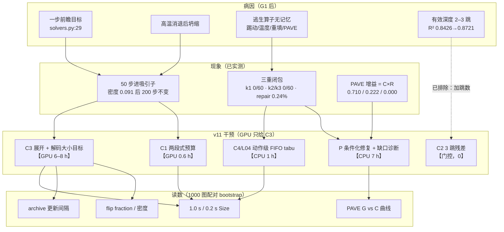

# RLNN v11 · 方向锁定（DRAFT v3 —— 已按 captain 2026-11-17 裁决改五处，待核对）

> 依据：`docs/temporary/RLNN_v11_Diagnosis.md`（诊断）、
> `docs/temporary/RLNN_v11_Literature_2024_2026.md`（文献）、
> `docs/temporary/RLNN_v11_G1_ReceptiveField.md`（G1 实测判决）、captain t3 补充意见（三条）。
> **状态：草案。** 只送审，不定稿；captain 明确批准后才改口径、才把 t3 标 completed。

---

## 0. 判决摘要

### 0.1 G1 之后作废的表述（沿用旧说法视为未审查）

| 旧表述（诊断 §2.5 / §5.1） | G1 实测 | 本文件采用 |
| --- | --- | --- |
| 有效感受野 = 1 跳，策略 ≈ (x_i, 选中邻居数) | R² 0.8426 → 0.8617(+c2) → 0.8721(+c3)；整跳翻转影响 29.38 / 15.18 / 4.01 / 0.35 / 0.013（hop 1–5）；>5 跳对照 max 0.0156 | **有效深度 2–3 跳；逐节点权重按跳几何衰减（1 跳的 ~1/20 量级，整跳聚合口径）**；5 层用不满 |
| 不动点源于「1 跳感受野 + 均值聚合」的表达力截断 | 策略看得到 2–3 跳 | **不动点源于优化轨迹吸引子**：一步前瞻目标（`models/solvers.py:29`）+ 高温消退后坍缩 + 无记忆逃生算子 |
| C2 天花板 +0.05，主线候选 | c2/c3 已有真实增量解释力 | **C2 降级**：天花板 +0.02 量级；先过 G2′ 残差探针（R² 0.872→≥0.90）才准进矩阵，否则关闭 |
| 「加跳数」是补救方向 | 同上 | 「加跳数」整类关闭；只有**改目标 / 改候选池 / 改预算分配**有非零期望 |

平台结论不变（三重不动点，诊断 §2.2–§2.6）；变的是病因，因而变的是下刀处。

### 0.2 口径写死

**唯一参照值：`20.1020 @ 3.046 s`**（`RLNN_v8_Paper_Table.md` / `RLNN_v8_Positioning_Results.md` 口径）。

三条理由：
1. `README.md:28` 的 `20.1060 @ 1 s` 与同仓库更细的测量冲突，且**不可复现**：`--time_limit=1` 时
   1000 图只有 99 张真的在 1 s 内返回，那 99 张均值是 **19.8384**（`RLNN_v8_SOTA_Direction.md` §0.5），
   20.1060 无法由「1 s 内完成的图」算出。
2. KaMIS 墙钟地板 1.87 s（同上）——「1 s 档」从来不是 KaMIS 的有效档位。
3. 论文草稿（v10 snapshot）已在用 20.1020。

**两个可审计事实（captain 裁决 Q1 要求：本文件与论文必须同时出现，不许只写其一）**

| 事实 | 数值 | 出处 | 它挡掉的说法 |
| --- | --- | --- | --- |
| `--time_limit=1` 的有效覆盖 | 1000 图只有 **99** 张在 1 s 内返回，这 99 张均值 **19.8384** | `RLNN_v8_SOTA_Direction.md` §0.5 | 「KaMIS 1 s 能到 20.10」 |
| KaMIS 墙钟地板 | **1.87 s**（`--time_limit=0.1` 也要 1.87 s 才返回；≤1.87 s 只有 217/1000 图） | 同上 | 「1 s 档可比」 |

> 一句话：20.1060 是「给它 1 s 限额、它花了 3 s」的均值，不是 1 s 档成绩；把它写成 1 s 档，
> 审稿人只要问「那 99 张均值多少」就穿。

**TODO（定稿前必做，captain 裁决 Q1）**：把 `README.md:28` 的 `20.1060 @ 1 s` 改成与论文一致的
`20.1020 @ 3.046 s`（README 现在同段里同时出现 20.1060@1 s 与 20.1020@3.05 s，自相矛盾，审稿人一眼可见）。
本文件不改 README（本轮不动代码与既有文档），只登记 TODO，由 captain 决定改的时机。

由此写死：
- 我们 1 s = **20.0685**（K=200 dense+fp16、808 步、1000 图、seed 1017）。
- 缺口 = **+0.0335**；每图多 1 点 = 均值 +1/1000 ⇒ **约 34/1000 张图各多 1 点**。
- 论文只写「**1 s 档 vs 3.05 s 档**的 SIZE 比较」，并明写「不主张 TIME 优势」。

### 0.3 外部锚点：怎么用 FLD，怎么不越界

FLD（NeurIPS 2025）Table 1（PDF p.7）在**同一基准** RB-[200–300] 上：

| 方法 | Size | 时间 |
| --- | --- | --- |
| Gurobi | 19.98 | 47.57 min |
| KaMIS | 20.10 | 1.40 h |
| FLD-EG | 20.02 | 38 s |
| RLSA | 19.97 | 35 s |
| RLNN | 19.52 | 1.64 min |
| 我们（1 s 档） | **20.0685** | **1 s** |

**用法（只此一种）**：回答审稿人「为什么不与 SOTA 采样器比」——38 s 的当前 SOTA 采样器 20.02
低于我们 1 s 的 20.0685，说明**预算区间不同、数字不可比**。
**禁止**：把 20.0685 与 20.02 写成「我们更强」，或与 19.97@35 s、20.10@1.40 h 做任何跨预算互比。
论文里这句话必须与「不主张 TIME 优势」写在一起。

### 0.4 主线与备份（一条主攻，GPU 押一处）

| 位置 | 线 | 一句话 | 算力 | 归属 |
| --- | --- | --- | --- | --- |
| **主攻（GPU 押这里）** | **C3** | 训练目标从「一步占据期望」改成「**解码后独立集大小的 40 步展开**」 | **8.5 GPU·h**（含闸门/探针；含 A2′ 9.8） | §2，t5 写码 / t7 跑 |
| 并行 CPU 小队 | **C4/L04** | 动作级 FIFO tabu：让平台搜索在等规模解之间真的走动 | 1 h CPU + 0.6 GPU·h（仅在通过后合成） | §3 |
| 并行 CPU 小队 | **P（命题 R）** | PAVE 从「后处理排序器」改写成「条件化修复 + 闭包缺口诊断」 | 0 GPU，≈7 h CPU | §4，论文侧 |
| 备选 | **C1** | 两段式粒子预算（0.6 s K=200 → 0.35 s K=20） | 0.6 GPU·h | §5 |
| 门控 | C2 | 3 跳加性残差 | 0（探针） | §6 |

**为什么只押 C3 进 GPU**（captain 问 (ii)）：
1. **C4/L04 与 P 都不需要训练**。押 GPU 的意义是「买训练算力」，而这两条没有任何可训练参数，
   放进 GPU 队列只会排队占卡，不会更快。
2. **C4/L04 的判决是纯 CPU 的 1000 图统计**（8 轮接受率），30 min 出结论；它的探针一旦通过，
   再花 0.6 GPU·h 合成到 1 s 臂上——顺序是「先证机制，再买算力」，不是反过来。
3. **P 是 CPU 位运算**（`platform_search` 全 CPU），且它的判据是统计量（ρ、R²），与 GPU 无关。
4. 反过来，C3 是唯一**必须**训练才能测的线；也是唯一同时可能改善 1 s 与 0.2 s 两档的线
   （0.2 s 档 414 步，正好落在展开窗口量级上）。

### 0.5 成功判据（能在现有 1000 图协议上直接测；写死最小幅度）

按 captain 建议，S1 改为**析取**（不再要求两档同时改善）：

- **S1（必达，二选一）**
  - (a) 1 s 档 Δ ≥ **+0.020** 且图级配对 95% CI 不含 0；或
  - (b) 0.2 s 档 Δ ≥ **+0.030** 且 1 s 档不让位（Δ ≥ −0.005）。
  - 两种情形都必须满足**排他对照**：与 C3 同 epoch 数的 erdoes 对照臂（A1′）Δ ≤ +0.005；
  - 两种情形都必须满足**三 seed 稳健性**：pooled 三 seed 的 5000 次自助 CI 不含 0、且 ≥2/3 seed 同号为正；
    任一 seed < −0.010 判「不稳」（不进论文主张，见 §2.7）。
- **S2（论文结构侧，按裁决 Q3 的门判定）**：命题 R 的 P1/P2/P3 —— **≥2 条过 → 三支柱**
  （systems + diagnosis + conditional repair，按可复现规格写）；**恰好 1 条 → R 降为 Discussion 诊断器**，
  不设独立实验；**0 条 → 整条关**。三种情形都不影响 S1 的判决。
- **S3（不作判据）**：1 s ≥ 20.1020。**概率 ≤ 0.2，且已明说不作为靶子**——理由见 §0.6。

### 0.6 明说：1 s 越过 20.10 不可达（不作为判据）

- G1 之后 C2 关闭，只剩 C3（+0.02 量级）与 C1（+0.02 量级）；两者都在「同一秒内让搜索更有效」，
  上游证据是**步数饱和**（`README.md:57`：700 步后每翻倍只值 +0.01）与**捕获摊薄已吃掉大部分**
  （+0.050），相加不是线性。
- 乐观组合估计 +0.03~+0.04 → 20.10~20.11，概率低；单线期望 20.09。
- 因此 S3 只作加分。**不为好看保留一个注定失败的靶子**。

### 0.7 三个问题（我提的，保留原文以便回溯）

1. **口径**：§0.2 选 `20.1020 @ 3.046 s` 是否批准？（备选：坚持 `20.1060 @ 1 s`，则需补跑
   `--time_limit=1` 全 1000 图，约 2 h CPU，且受 1.87 s 地板限制，大概率仍拿不到 20.1060。）
2. **GPU 预算与排队**：C3 允许「展开 40 步 × 2 训练种子 × 6 epoch + 2 个超参点」吗？估算 6–8 GPU·h，
   需 GPU1 连续约 8 h。上限设 30 GPU·h、允许拆成 3 段可中断执行，是否批准？t5 是否直接由我把
   `train_scripts/v11/c3.sh` 交给你在服务器启动（我不在服务器上跑）？
3. **论文定位**：命题 R 是**独立贡献**（三支柱：systems + diagnosis + conditional repair），
   还是 PAVE 升级的**附属消融**（两支柱，R 只进 Discussion）？决定 §4 是否按「可独立复现」规格做
   （多 4 h CPU + 一条外部可复现脚本）。

### 0.8 captain 裁决（2026-11-17）

**行号更正（我的错，全文已改）**：`models/solvers.py` 的 `graph_batch_loss` 在 **427**，不是 426。
抽查通过的四条无异议：`mis_v3_search.py:197 forbidden=reverse(action)`、`:247 repair() 无 tabu 参数`、
`:340/:384 history[-2:]`、`mis_v8_pad.py:96/:207/:222`（节点级 tabu 掩码）。

**Q1 口径：批准 `20.1020 @ 3.046 s`。** 条件已落实：§0.2 新增「两个可审计事实」表（99/1000 图 + 那 99 图
均值 19.8384；墙钟地板 1.87 s、≤1.87 s 只有 217/1000 图），并登记 TODO：定稿前把 `README.md:28` 的
`20.1060 @ 1 s` 改成与论文一致。

**Q2 预算：批准。** 名义 **10 GPU·h**、硬上限 **30**、允许拆 **3 段**可中断、只占 **GPU1 单进程**。
执行分工落定：**t5 写码 + 冒烟、t7 跑全网格**；direction **不上服务器**（无免密 ssh），只交脚本与判据
（§9.1 已按此改写）。

**Q3 定位：R 作独立第三支柱，但带门。** P1/P2/P3 **≥2 条过 → 三支柱**（systems + diagnosis + conditional
repair），按「可独立复现」规格做，+4 h CPU 批准；**恰好 1 条过 → R 降为 Discussion 诊断器**，不设独立
实验；**0 条 → 整条关**。门写进判决（§4.3 已改），不到写作期再议。

**五处必改，逐条落点：**

| # | 裁决原文要点 | 我的落实 | 落点 |
| --- | --- | --- | --- |
| 1 | 训练 K=20 vs 部署 K=200 是新的 train≠deploy 漏洞，不许默认忽略；要么论证 K 不变性 + 6 ep K=64 对照，要么训练提到部署量级 | 给**代码级论证**（前向对粒子列可分离、`models/models.py` 无 BatchNorm/LayerNorm、档案不回写采样），同时新增 **A4（K=64、6 ep、其余全同）** 作经验对照，并写死「A4 显著更好 → 训练 K 升 64」的升级规则 | §2.5（论证段）、§2.6（A4 行） |
| 2 | horizon 40 vs 808 须明写「仍是近视目标」；archive 更新间隔作 H1 观测证据；补训练期解码口径（每 10 步取最后一次而非最大，写清理由） | 三段新文：近视声明（覆盖率 5%）、解码口径三条理由 + `max` 只作诊断不反传、H1 机制通道写成必要条件 | §2.5（口径段） |
| 3 | A0 必须是硬闸门：同配方服务器重跑 1 s 须复现 20.0685 ± 0.002 才开 A1；A1′ 除 loss 外逐项相同并给对照表 | 新增「门 0」判据 + A1/A1′ 同配置对照表 + 「只有 loss 不同」的审计方式（共用 `c3.sh`，`run.json` 逐字段 diff 应只差 `loss`） | §2.5（对照表）、§2.7（门 0） |
| 4 | C3 梯度必须自证（~30 行探针：非零梯度、方向与解码大小正相关、init 无 NaN） | 新增 §2.9：`models/probe_unroll_grad.py` 五项检查（有限性/非零/符号对照/ρ/失败处置），不过不许开 A1 | §2.9 |
| 5 | 主判据只认 A0 vs A1 图级配对 5000 次自助 CI；决赛臂跑 3 评测种子 1017/1019/1021；A2 赢了也只作消融 | 判据改写（**pooled 三 seed** 5000 次自助、**≥2/3 同号为正**、任一 seed <−0.010 判不稳）；矩阵加三 seed 成本；明写 A2 不进标题/摘要 | §2.6、§2.7 |
| 3′ | 门 0 分双口径（收紧）：(i) 固定 808 步、±0.0005；(ii) 1 s 只记录步数/ms 每步，差 >0.005 先比步数差 >10% 判「机器速度不同」 | §2.7 门 0 已重写为两口径 + 判死规则；`--fixed_steps` 列为 t5 待加 3 行 | §2.7、§2.10 |

**我不同意的两处（保留理由，请复核）**

1. **不同意「训练 K 提到部署量级 200」作为默认动作**。显存算术：5 层 ×128 宽 ×264 节点 ×K ×40 步 ×4 B，
   K=200 时激活约 **16 GB**，加反向缓冲逼近或超过 GPU1 容量；而 K 的列可分离性有代码依据（无 BN/LN），
   A4 用 K=64 已能回答「K 是否进入策略输入分布」。若 A4 显示 K 显著（≥+0.015），再上 200 是**有证据地**
   花 3 倍显存，而不是一开始就默认。所以我的落实是「论证 + 64 对照 + 升级规则」，不是直接上 200。
2. **A4 用 6 ep 而不是「短对照」**。只跑 2–3 ep 无法区分「K 影响轨迹」与「K 影响收敛速度」，且省不下
   多少（K=64 单步 ≈3.2×，6 ep ≈1.6 h）。若你要求压到 2 ep，A4 从 1.9 → 1.0 GPU·h，我照改。

**其余保留项**（S1 析取、S3 不作靶子、C4 kill 照抄 AR=0 即停、C2 门控 R²≥0.90、C4 不与 C3 同时上线、
MATLAB 五条、三级回退）全部未改。

---

## 1. 机制图



读法：G1 剪掉了「表达力不足」这条支路；剩下的活路是「改目标」（C3，需训练）、
「改候选池」（C4/L04、P，纯 CPU）、「改预算」（C1，零训练）。

---

## 2. 主攻 C3：尺寸感知的展开训练目标（GPU 押这里）

### 2.1 机制一句话

训练目标是「**一步之后**的占据期望 + 规模惩罚」（`models/solvers.py:29 erdoes_graph_batch_loss`），
部署比的是「**跑 808 步之后解码出来的独立集大小**」。C3 把目标换成后者在 40 步上的展开：
策略第一次能拿到「保持走动 40 步是否更好」的梯度，而不是「下一步该不该翻」。

### 2.2 为什么这条能过 G1 的门

- **与感受野无关**：G1 证伪的是「加跳数」，C3 不动网络结构、不动 hop，只动 loss。
- **病因明确**：D2（训练≠部署）是诊断 §2.5 三条机制之一，且是唯一**没被 v1–v10 直接测过**的
  （`RLNN_v8_Retrain.md` 只在 `--loss erdoes` 下测冻结步数曲线，没换过 loss 本身）。
- **现象可观测**：C3 生效应看到 `archive 更新间隔` 变短、`flip fraction` 上升、`density` 不再 50 步定死
  （当前 0.091/0.095/0.099 到第 200 步仍不变，`RLNN_v9_SOTA_Hunt.md` §4）。

### 2.3 可证伪假设

- **H1**：warm start + 40 步展开 + 解码大小目标，6 epoch 后，1000 图 seed 1017 上
  满足 S1（§0.5）；机制通道成立的必要条件是 `archive 更新间隔` 中位数下降 ≥ 30%。
  **证伪**：S1 不成立，或 1 s Δ < +0.005 且 0.2 s Δ < +0.015，或间隔不降 → C3 关闭。
- **H2（排他解释）**：增益不是「多训了 6 epoch」。同 epoch、同 lr、loss 仍为 erdoes 的对照臂 A1′
  必须 Δ ≤ +0.005。若 A1′ 也 ≥ +0.02 → H1 作废，C3 降级为「重训即可」，不算方向创新。

### 2.4 代码改动点（文件级）

| # | 文件:位置 | 改什么 | 为什么必须改这里 |
| --- | --- | --- | --- |
| 1 | `models/solvers.py:427` `graph_batch_loss()` | 加 `unroll` 分支 → 新函数 `unroll_graph_batch_loss(...)` | loss 的唯一汇入点（现硬绑 erdoes） |
| 2 | `models/solvers.py:391-396`（loss 分派）＋`models/main.py:38`（`--loss` choices） | 注册 `unroll` | 训练脚本要能选到 |
| 3 | 新文件 `models/mis_v11_unroll.py` | 40 步可微展开：`logits→probs→Bernoulli(ST)→state`，每 10 步解码，`loss = −mean(解码大小)`（可选 + archive 更新奖励） | 现有 `_body()` 在 `models/mis_v8_pad.py:239 _build()` 被 CUDA Graph 捕获，**无 autograd**；训练必须走 eager |
| 4 | `models/mis_v8_pad.py:328 eager_step()` / `:343 _body_one()` | 复用为训练侧 stepper（或抽公共函数） | 已有逐位一致 eager 路径，避免第二套语义 |
| 5 | `models/mis_v8_pad.py:319 decode_best()` 的 ST 版 | 用 `problem.decode_gradient_flip`（调用方式见 `models/eval_v8_padded.py:54`）做解码大小直通梯度 | 目标量是解码后大小，不是能量 |
| 6 | `models/eval_v8_padded.py:167-240` | 不动，只换 checkpoint | 保证 1000 图协议逐位可比 |

**不改**：`models/models.py`（网络）、`models/mis_v3_search.py`（PAVE 冻结协议）、
`models/mis_v8_pad.py` 的部署路径。

### 2.5 训练协议（写死；A1 与 A1′ 逐项同，只有 loss 不同）

| 项 | A1（C3） | A1′（对照） | 依据 |
| --- | --- | --- | --- |
| 初始化 | `outputs/v2/none_seed0/checkpoints/best.pt`（668 801 B） | **同** | 从零不可替代（30 ep 18.92 vs 冻结 19.52） |
| epoch / lr | 6 / 2e-5 | **同** | 对齐 `RLNN_v8_Global_Token.md` 微调协议 |
| **loss** | `unroll`（40 步展开、解码大小） | `erdoes`（现成） | **唯一不同项** |
| 训练粒子数 K | 20（A4 另测 64） | **同** | 见下方「K 不变性论证」 |
| 展开 / 解码节奏 | 40 步，每 10 步解码，**取最后一次**反传 | 无展开（一步） | 见下方「训练期解码口径」 |
| 验证 | 前 200 图，每 epoch | **同** | `RLNN_v8_Retrain.md` 协议 |
| 终评预算 | 1.0 / 0.2 s × 1000 图 | **同** | README 主协议 |
| 评测种子 | 1017 / 1019 / 1021 | **同** | 单种子是 #13 的病根 |
| 训练种子 | 0（第二种子只在最优超参点） | 0 | — |

**「只有 loss 不同」怎么审计**：两臂共用同一份 `train_scripts/v11/c3.sh`，A1′ 只把 `--loss unroll`
换成 `--loss erdoes`；训练结束把两臂 `run.json` 的超参快照逐字段 diff，**除 `loss` 外必须为空**，
diff 结果作为 A1 的必需附件（captain 裁决 3）。

#### K 不变性的代码论证（回应裁决 1）

1. **前向对粒子列可分离**：`models/mis_v8_pad.py:193 _logits()` 只吃 `state`(n_max×K)、固定归一化邻接与
   `bias`；`models/models.py:71 GCNConv.forward` 是 `spmm(A, X)` + 逐点 Linear；`models/models.py` 全文
   **无 BatchNorm/LayerNorm**（grep 无命中）⇒ 第 j 列输出只依赖第 j 列输入，列间无混合。
2. **唯一跨粒子的是档案**：`_body()` 里 `energy < best_energy` 只决定「记哪个解」，**不回写采样**
   （`erdoes` loss 也不读档案）。所以 K 改变的是「同时采多少列」与「解码取 max 的统计量」，不是每列的动力学。
3. **但不是逐位相等**：噪声按 (n_max, K) 行主序抽样，K 变了列内抽样位置就变 ⇒ 结论是**边缘分布等价**，
   不是逐位等价。这正是必须配 A4 经验对照、而不能只靠论证的理由。
4. **A4 判据与升级规则**：A4（K=64）− A1 ∈ [−0.005, +0.010] ⇒ K 无关，A1 作主叙事；A4 − A1 ≥ +0.015
   ⇒ 训练 K 升到 64 并重跑 A1（预算 +2.0 h，从 30 h 上限出）；A4 掉 >0.01 ⇒ K 是隐变量，0.2 s 档
   （部署 K=20）仍可叙事，1 s 档必须标注「训练/部署 K 不同」。

#### 训练期解码口径（回应裁决 2）

每 10 步解码一次、共 4 次，**取最后一次反传**。三条理由：

1. `max` 只把梯度给 argmax 那一次解码，4 个不连续目标之间抖动大（相当于次梯度方差放大），小 lr 下等于噪声。
2. 取最后 = 训练「40 步末端的策略质量」，与逐 epoch 收紧的视界一致，梯度指向单一时刻，可解释。
3. 「808 步内最好」不可微、40 步内也近似不了；硬把 `max` 塞进 loss 只会让梯度奖励「第 40 步恰好抽到好解」
   的偶然。

**补偿（不是放弃诊断）**：4 次解码的 `max` 与 `last` 都记为诊断指标（**不反传**）。若 A1 的增益主要来自
末端偶然，`max − last` 会显著（>0.01）；届时读作「目标噪声」而非真实提升，触发 §2.7 的复核。

#### 近视声明（回应裁决 2）

**这仍是近视目标，只是近视窗口从 1 步拉到了 40 步**；部署 808 步，窗口覆盖率约 **5%**。本线**不主张**
解决长期信用分配，只主张**把评价口径从「一步能量」换成「解码后的独立集大小」**——而这个口径正是部署时
真正被度量的量。H1 的机制通道（`archive 更新间隔` 中位数降 ≥30%）是「轨迹真的变了」的**必要条件**，
不是旁证：间隔不降，说明策略仍在同一条吸引子上，C3 就是无效的。

### 2.6 实验矩阵

| 臂 | 训练 | 终评 | 图数 | GPU·h |
| --- | --- | --- | --- | --- |
| **A0 冻结基线（硬闸门）** | — | 1.0/0.2 s × **3 seed** | 1000 | **1.0** |
| A1 C3-40 | 6 ep, lr 2e-5, K=20 | 1.0/0.2 s × **3 seed** | 1000 | 1.0+1.0 |
| A1′ erdoes 对照 | 6 ep, 同 lr/K/节奏 | 1.0/0.2 s × **3 seed** | 1000 | 1.0+1.0 |
| A2 C3+archive 奖励 | 6 ep | 1.0/0.2 s × 1 seed | 1000 | 1.0+0.3 |
| **A4 K=64 对照** | 6 ep, K=64，其余同 A1 | 1.0/0.2 s × 1 seed | 1000 | 1.6+0.3 |
| A2′ 第二训练种子（条件：A1 过） | 6 ep | 1.0/0.2 s × 1 seed | 1000 | 1.0+0.3 |
| A3 展开 80 步（条件触发） | 6 ep | 1.0 s × 1 seed | 1000 | 1.6+0.3（不计入小计） |
| B1 C1 两段式（并行） | — | 1.0 s × 1 seed | 1000 | 0.3 |
| **小计（不含 A2′/A3）** | | | | **8.5** |
| **含 A2′（A1 通过后）** | | | | **9.8**（名义 10，硬上限 30） |

成本口径：训练 ≈5 min/epoch（200 图 × 40 步 × 0.35 ms 前向 ×~3 含反向）+ 验证 ≈95 s/epoch；K=64 ≈3.2×
单步；一个种子的双预算终评 = 1000 图 ×(1 s + 0.2 s) ≈ 0.35 h，三 seed ≈1.0 h。**均为估算，A0 跑完用
`run.json` 实测替换**（A0 同时充当成本标定）。

### 2.7 判据与停止

- **门 0（A0 硬闸门，先于一切）——必须分双口径**（captain 2026-11-17 收紧）：
  1 s 是 **deadline 驱动**，步数随机器负载变（808 步是当时那台机器填满 1 s 的结果），换卡重跑步数必然不同，
  所以「±0.002」单独用会把协议自检误判成协议坏。两个口径分开写：

  - **(i) 步数匹配口径（确定性，主闸门）**：同臂 `padded/captured`、K=200、dense+fp16、**固定 808 步**
    （= 80 块 × chunk 10）、seed 1017、1000 图 → 必须复现 **20.0685，容差 ±0.0005**（同一权重同一代码应
    逐位一致；残差只来自 fp16 dense 归约顺序）。这条与机器速度无关，是真正的协议自检。
    命令：`--fixed_steps 808`（= `engine.run(float("inf"), ..., max_blocks=ceil(808/chunk))`，
    **需 t5 加 3 行透传**，见 §2.10）。
  - **(ii) 时钟口径（报告，不设死容差）**：1.0 s deadline 跑一次，**必须记录实际步数、ms/步、load 秒**。
    若 (ii) 与 20.0685 差 >0.005，先看步数差：**步数差 >10% ⇒ 判定「机器速度不同」而非协议坏**，该次结果
    标注 `steps=`，**不得混入与 A0 的对照池**。
  - **判死规则**：(i) 不过 → **停，不许开 A1**；(i) 过而 (ii) 偏离 → 照跑 A1，但所有对照一律用**同一次
    会话内**跑出的 A0 数字（**不许拿三周前的 20.0685 当对照**）。
- **主判据只认统计量**：A0 vs A1 的**图级配对、5000 次自助重采样的 95% CI**（`paired_bootstrap`，
  `models/eval_pave_external.py:96`，`rounds=5000`），不看单点均值差。
- **三 seed 判据（captain 2026-11-17 改，防假阴性）**：决赛臂（A0/A1/A1′）跑 1017/1019/1021。
  - **主判据**：A0 vs A1 图级配对、**pooled（三 seed 合并）** 5000 次自助 95% CI 不含 0，且
    Δ ≥ **+0.020**（或 0.2 s 档 ≥ **+0.030**）。
  - **稳健性**：三 seed 中 **≥2 个同号为正**（单 seed 噪声 ≈±0.005，真效应 +0.02 时要求「三 seed 全正」
    会把真效应判死，假阴性比假阳性更贵——本轮只有一次机会）。
  - **降级条件**：任一 seed **< −0.010 ⇒ 判「不稳」**，不许进论文主张，降为 Discussion 的观察。
- 成功：门 0(i) ∧ S1 ∧ H2（A1′ ≤ +0.005）∧ 三 seed 稳健（pooled CI 不含 0、≥2/3 同号、无 seed < −0.010）。
- 死刑（任一即停，不加投第三种子、不做 A3）：
  1. A1 − A1′ < +0.010；
  2. 1 s Δ < +0.005 或 CI 含 0 **且** 0.2 s Δ < +0.015；
  3. `archive 更新间隔` 中位数下降 < 10%（机制通道不成立）。
- 超时：单臂 90 min 不收敛（valid_obj 连续 2 epoch 不降）→ 停，记负数。
- **A2 的定位**：即便 A2 > A1，主叙事仍是 A1（换目标）；A2 只作「目标变体」消融，**不进标题、不进摘要**。

### 2.8 风险

1. 40 步 ST 梯度方差大，前 2 epoch 可能崩到 18.x → lr 2e-5 起、每 epoch 存 best、崩了回 A1′。
2. 增益来自「多训」→ A1′ 就是为此设的。
3. 训练 fp32 / 部署 fp16 错配（logit 差 6.3e-2，`RLNN_v9_SOTA_Hunt.md` §6）→ 部署设置不变，配对抵消。
4. 8 h 连续占卡被抢 → 拆 3 段可中断。
5. **K 与 horizon 是新引入的 train≠deploy 缺口**（裁决 1/2）→ K 用论证 + A4 + 升级规则封顶；
   horizon 用「近视声明 + 机制通道必要条件 + `max−last` 诊断」封顶，不许在论文里写成「解决了长期信用分配」。
6. 「训练期取最后一次解码」与「部署期取 200 列 × 808 步的 max」仍有口径差 → 论文里明写这两套口径，
   并用 `max−last` 的差值说明差异量级。

### 2.9 C3 的梯度自证探针（回应裁决 4；GPU ≈5 min）

没有这个探针，A1 掉到 18.x 时**无法区分「目标错」与「实现错」**（v8 `--loss erdoes` 一步前瞻的病根也是这样
埋下的）。因此写码时同批交付 `models/probe_unroll_grad.py`（≈30 行，只读，不改训练路径），20 张验证图、
K=20、40 步，五项检查：

| # | 检查 | 判据 | 不过的含义 |
| --- | --- | --- | --- |
| 1 | 有限性 | init 时 `loss.item()` 有限、`logits` 全 finite、无 NaN | ST/解码里出现 0/0 或 `log(0)` |
| 2 | 非零梯度 | `loss.backward()` 后 `logits.grad.abs().sum() > 0`，且 `grad.std()/grad.abs().mean() > 1e-3` | ST 被误 `detach`；或只产生常数偏移 |
| 3 | **方向正确** | 沿 `−∇` 小步（η = 1e-3·‖θ‖/‖g‖）改 logits，同 40 步同种子重算解码大小，20 图平均 **Δsize > 0**；沿 `+∇` 必须 **< 0** | loss 符号写反（应为 `−size`）或解码 ST 方向反 |
| 4 | 与解码的关系 | 以图为单位，梯度范数 vs 上升后 Δsize 的 Spearman **ρ > 0.2** | 梯度与目标不同向，目标定义或解码 ST 有问题 |
| 5 | 尺度合理 | `‖g‖` 与 `‖logits‖` 同量级（比值 ∈ [1e-4, 1e2]） | 归一化/温度写错，lr 会失真 |

**门**：1–4 全过才允许开 A1；任一不过先修实现，**不许带着未验证的 loss 上 6 epoch 训练**。产物
`outputs/v11/probe_unroll_grad.json` 随 A1 一并交付。

### 2.10 门 0 需要的 3 行改动（`--fixed_steps`，t5 落地）

`models/eval_v8_padded.py` 现在只有 deadline 驱动（`engine.run(cutoff, ...)`），无法做「固定 808 步」的
确定性复现。`models/mis_v8_pad.py:259 run()` 已支持 `max_blocks`，所以只需透传：

```python
parser.add_argument("--fixed_steps", type=int, default=0,
                    help="0 = deadline 驱动；>0 = 固定步数（门 0 的步数匹配口径）")
...
if args.fixed_steps:
    cutoff = float("inf")
    blocks = math.ceil(args.fixed_steps / args.chunk)
    steps, decode_seconds, blocks = engine.run(cutoff, decode, max_blocks=blocks, ...)
```

判据不变：`--fixed_steps 808 --arms padded --decoders captured --num_k 200 --dense --fp16 --seed 1017
--graphs 1000` → 20.0685 ± 0.0005。**这是门 0 (i) 的前置条件**；t5 若不加，门 0 只能退化为 (ii) 时钟口径，
届时 A1 的对照必须整批重跑同会话 A0。

---

## 3. C4/L04：动作级 FIFO tabu（把诊断 C4 与文献 L04 合并成一条）

### 3.1 一句话

L04（AlphaZero+Tabu，IJCAI 2024，PDF p.5 §5 + Alg.1）禁的是「**最近做过的动作**」，
不是「访问过的状态」；我们的 C4 想要的正是这个。合并成一条：**在候选池生成和修复路径上
同时挂一个长度 h 的动作 FIFO**，让平台搜索在**等规模解**之间走动，而不是回到原解。

### 3.2 现有实现到底是什么粒度（行号级，这是本条的关键）

| 层级 | 现有代码 | 粒度 | 记忆长度 | 作用范围 |
| --- | --- | --- | --- | --- |
| v3 平台搜索（rollout 内） | `models/mis_v3_search.py:297` `candidate_actions(..., tabu=(action,))`；`:197` `forbidden={reverse(a)}`；`:210` `if (removed,(node,)) in forbidden: continue` | **动作级，但只禁「精确逆动作」** | **1**（就刚做的那一个） | 只作用于 `rollout` 的 stage≥1，stage 0 无 |
| v3 平台搜索（外层） | `:380` `candidate_actions(..., tabu=result.history)`；`result.history = tuple(history)[-2:]` | 动作级 | **≤2**（滚动窗口） | 只作用于 `candidate_actions`，**不作用于 `repair()`** |
| v3 修复路径 | `:247 repair()` 签名里**没有 tabu 参数**；`:265` 每次直接取 `improving_actions(...)[0]` | **无记忆** | 0 | 这是「每次收敛回原解」的代码级原因 |
| v10 受禁破坏-修复 | `models/mis_v8_pad.py:96` `self.tabu`（nodes×K bool）；`:207` `_logits()` 末行 `masked_fill(self.tabu, min)`；`:219 release()` 清零；`models/mis_v10_lns.py` `_destroy/on_block` | **节点级（状态级）** | 一个 block 周期（随后 release） | 禁的是被破坏的点被重新选中 ⇒ 修复只能回到同一解 |

结论（三句话，写清差异）：
1. 我们**已经有**动作级 tabu，但**只有深度 1–2，且只禁精确逆动作**，等于「不许立刻撤销」；
   L04 要的是「最近 h 个动作都不许再做」，深度 h≫2。
2. 真正让解回到原点的是 `repair()`（`:247`）——它**完全没有记忆**，破坏-修复每次都在同一个
   局部最优上收敛。这解释了 v10「受禁破坏-修复 20/20 图同解」：禁的是节点，恢复后修复仍走同一条路。
3. v10 的「受禁」是节点级，与 L04 的动作级不是一个东西——**这是本条线最容易被误读成重复的地方，
   必须写清**。

### 3.3 改码点

| # | 文件:位置 | 改什么 |
| --- | --- | --- |
| 1 | `models/mis_v3_search.py:247 repair()` | 加 `tabu=()` 参数；`:265` 取动作时按 FIFO 过滤（`removed` 位掩码为键） |
| 2 | `models/mis_v3_search.py:197 candidate_actions()` | `forbidden` 从「精确逆动作」扩成「最近 h 个动作的 removed 掩码集合」，键用 `action.removed` |
| 3 | `models/mis_v3_search.py:340 platform_search()` | 维护 `deque(maxlen=h)`，跨 `outer_rounds` 传递；喂给 `repair()` 与 `candidate_actions()` |
| 4 | 新文件 `models/probe_tabu_walk.py` | 1000 图 × 8 轮 × h∈{8,16,32}，输出两个指标（下） |

约 40–60 行，无训练，无新模型。

### 3.4 两个可测指标（写死定义）

- **淘汰率**（tabu 是否有活干）
  `ER = 1 − |pool_with_tabu| / |pool_without_tabu|`，在同一 (graph, state) 上配对测，
  按 outer round 分桶；若 ER ≈ 0（FIFO 从没命中过任何候选）→ 说明动作空间太小、tabu 无意义。
- **平台解接受率**（走动是否真的发生）
  `AR = 8 轮中「结束解 size 与轮初相同、Hamming > 0、且未刷新 archive-best」的轮数 / 8`。
  当前实测 = **0/8**（v10：周期 10 三档半径逐位相同、20/20 图同解）。

### 3.5 探针与判据

```bash
# 服务器 CPU（不需要 GPU），约 30–60 min
cd /home/hzeng/project/ZH/RLNN_lab
/home/hzeng/envs/rlnn/bin/python -u models/probe_tabu_walk.py \
  --test_path models/data/MIS_tensors/RB_small_author_test \
  --graphs 1000 --outer_rounds 8 --h 8,16,32 --budget 0.1 \
  --rankers outputs/v3/stats_h1_seed0/checkpoints/best.pt \
  --result_dir outputs/v11/tabu_walk
```

- **成功**：AR ≥ 1/8（1000 图均值）**且** ER ∈ [0.05, 0.6]（既非空转也非锁死）。
- **死刑（文献给的，照抄不调）**：8 轮内等规模平台解接受率仍为 0 → **立刻停，不许调 h**。
- 次级判据：若 AR > 0 但 1000 图 SIZE 不变 → 走动不含「找到 +1」的通道，本条降级为
  「候选池非空但仍无增益」的独立证据（对论文仍有用）。

### 3.6 与 C3 的合成路径

只有 AR 过线才花算力：在 1 s 臂的末端 PAVE（`models/eval_v8_padded.py:248`）换上 tabu 版 `platform_search`，
1000 图重测一次（0.6 GPU·h）。**不与 C3 同时上线**，避免归因不清。

---

## 4. P（命题 R）：条件化修复 + 闭包缺口诊断（第二创新点，CPU）

### 4.1 一句话

不再主张「PAVE 能提升多少」，而主张「**PAVE 的增益 = 输入闭包缺口 C × 选择器效率 R，且 C 可被
一个 ≤5 ms 的前向预测**」——把过时的后处理组件改写成**算子完备性度量**。

### 4.2 三个可测命题

| 命题 | 可计算量 | 协议 | 成功 | 死刑 | 成本 |
| --- | --- | --- | --- | --- | --- |
| **P1 定律** | Spearman ρ(G, C) 与回归斜率 | 100 图 × 6 档质量阶梯（随机 50% / 最小度贪心 18.38 / 捕获 0.05–1.0 s / KaMIS 0.1 s），预算 0.1 s，C 用 `platform_search(deadline=inf)` | ρ ≥ 0.8 且斜率 ∈ [0.6,1.1]，≥2 点 C > 0.1 | ρ < 0.3 | 4 h CPU |
| **P2 预算** | 0.2/0.5/1.0 s × 3 臂（PAVE-off / on / 搜索多 0.1 s） | 1000 图，`models/eval_v8_padded.py`，图级配对 | 0.2 s 档 ≥ +0.03 且优于「多 0.1 s 搜索」；1 s 档让位 ≥ −0.005 | 0.2 s ≤ +0.01 | 1.5 h GPU |
| **P3 诊断器** | stats→C 的 R²（`models/mis_v3_value.py` 24 维） | 800 训 / 200 测 | R² ≥ 0.3，门控省 ≥30% 时钟不掉质量 | R² < 0.1 | 2 h CPU |

三者独立判生死。**≥2 条过 → 触发裁决 Q3 的三支柱**；恰好 1 条 → R 降为 Discussion 诊断器；
0 条 → 整条关（见 §4.3）。任一条 4 h 未出数 → 记「待证」，按「未过」计入条数（不默认算过）。

### 4.3 定位说明（captain 裁决 Q3：带门的独立第三支柱）

P 不争 SIZE，争的是「**可预测的量**」与论文的第二支柱。它与 C4/L04 共享 `platform_search`，
但两者判据不同（P 测 G–C 关系，C4 测接受率），**可以并行不冲突**；若 C4 证明池空，
P 的结论反而更强（C≈0 是定律的一个端点）。

**门（写进判决，不到写作期再议）**：

| P1/P2/P3 通过数 | 论文结构 | 实验规格 | 预算 |
| --- | --- | --- | --- |
| **≥2 条** | **三支柱**：systems + diagnosis + conditional repair | 按「别人能复跑」做：固定 CSV 输入、单命令、随机种子、预期输出表 | +4 h CPU（已批准） |
| **恰好 1 条** | 两支柱：systems + diagnosis；R 降为 **Discussion 诊断器** | 不设独立实验，只报已算出的数 | 0 |
| **0 条** | 两支柱 | 整条关，不写入论文 | 0 |

三种情形都不改 S1/S3 的判据——R 是论文结构问题，不是 SIZE 问题。

---

## 5. 备选 C1：两段式粒子预算（零训练）

- 机制：前 0.6 s K=200（≈500 步，1.18 ms/步）→ 按档案能量取 top-20 → `prime()` 进 K=20 引擎
  （0.329 ms/步）→ 后 0.35 s 再跑 ≈1000 步。
- 与文献 B01（DORA，NeurIPS 2025）的关系：C1 是 B01 方向级 softmax 分配（Eq.9）的**硬 top-k 特例**；
  先验证「换宽度」方向本身，再谈加权。
- 代码：`models/mis_v8_pad.py:174 prime()` 已支持单列注入；新增 `models/mis_v11_ebudget.py`；
  驱动 `models/eval_v8_padded.py:167-240`。
- 探针：100 图 × 3 切分（0.5/0.5、0.6/0.4、0.7/0.3）× 2 选列（最低能量 / 解码最大）。
- 判据：S1 同门槛（+0.020 / +0.030），CI 不含 0；**不与 C3 相加**。
- 死刑：最好切分 < +0.010。
- 成本：0.3 GPU·h（1000 图 × 1 s ≈17 min）。

---

## 6. C2 的门：G2′ 残差探针（不训练，0 GPU）

- 事实：G1 说 c2/c3 的**整跳**增量是 51.7% / 13.6%，但逐节点权重只有 1 跳的 ~1/20，
  C2 的净增信息远小于原估（R² 侧 ~1–2 pp）。
- 探针（30 min）：在冻结骨干 logits 上加加性残差特征（度数补偿的每跳计数
  `e_k = c_k/sqrt(E[c_k|deg])`），最小二乘拟合，看 R² 能否 0.872 → **≥0.90**（或 logit 残差砍半）。
- 过线 → C2 以 +0.02 天花板进矩阵（+1 GPU·h）；不过线 → **关闭，不烧 GPU**。
- 论文只能写「残差特征解释力不足」，不能写「多跳无用」（G1 已证 2–3 跳有用）。

---

## 7. 文献 5 机制逐条裁决

| 排名 | 机制 | 裁决 | 理由 | 落点 |
| --- | --- | --- | --- | --- |
| 1 | **L04 动作级 tabu**（IJCAI24） | **采纳**，与 C4 合并为一条独立线 | 唯一「改候选池」且零训练；直接对撞 v10「受禁修复回原解」 | §3（CPU 小队） |
| 2 | **B01 方向级预算**（NeurIPS25） | **采纳**（以 C1 形式） | 我们的 1 s 切分是手工固定值；C1 是 Eq.9 的 top-k 特例 | §5 |
| 3 | **L06 破坏半径解耦**（AAAI25） | **不采纳**，只留 0.5 h 门诊 | v10 已测半径 2/3 全负、周期 10 逐位相同；先统计「k 跳破坏后可行 repair 比例」，<5% 不写代码 | §9 M0 |
| 4 | **L01 bandit 选算子对**（IJCAI25） | **不采纳为主线**，采纳为消融臂 | 收敛输入期望≈0；但「bandit vs ranker vs coverage」三臂能切开「排序器是否值得存在」，是负结果支柱 | P 的诊断子实验 D1（2 h CPU） |
| 5 | **L05 限步 rollout beam**（AAAI25） | **不采纳**（条件作废） | 池空时 beam = 0×β×α；等 L04 的 AR，为 0 则同时作废 | 挂在 §3.5 之后 |

第二梯队（记录不动作）：D01 FLD 重尾噪声（v10 已否退火家族；噪声族是新的但风险高）、
B02 Threshold UCT（域差大）、B05 CPU-GPU 异步（易复发时钟 bug）、L07 自适应切回（与 C1 重叠）。

明确不跟进：L03/L09（LLM 进内环与 1 s 不相容）、L08（RB 上结构性无效）、N01/N03/D03/B04、
L02 的 RL 部分、B03 的算法部分（只取叙事）。

---

## 8. 与 v1–v10 死路清单的一致性检查

| 死路（诊断 §6） | 本文件是否重复 | 说明 |
| --- | --- | --- |
| #1 加步数/捕获 | 否 | C3 固定 1 s；C1 是**换**宽度 |
| #2 k→k+1 交换 | 否 | 未动交换枚举 |
| #3/#4 球内精确修复 | 否 | C7 未入选 |
| #6 策略重填 +0.02 回原解 | **同源，但不重复** | C4/L04 正是为打断「回原解」；判据是 AR>0，若仍 0 则记为 #6 的第二次独立证伪 |
| #7 踢动 −0.033 | 否 | 不用踢动（那是无记忆的破坏） |
| #8 温度/退火 | 否 | 不用温度 |
| #9 末端 PAVE +0.004 | **同对象，立场相反** | 不主张 PAVE 提升 SIZE，改为诊断量（§4） |
| #10 PAVE 吃 KaMIS 0.000 | 否 | 不再用 KaMIS 解作输入测增益 |
| #11 交换进环 ≤0 | 否 | 未把交换塞进捕获循环 |
| #13 结构补偿单种子 | 否 | C3 用两个训练种子 |
| #14 频域 / #15 Mamba 静态先验 | 否 | 未动 |

---

## 9. 实验顺序、停止规则与预算

| 步 | 内容 | 算力/时间 | 通过 → 下一步 |
| --- | --- | --- | --- |
| **M0** | L06 门诊：k=2/3 跳破坏后可行 repair 比例 | 0.5 h CPU | ≥5% 才考虑 L06，否则永久关闭 |
| **M0.5** | **A0 硬闸门（双口径）**：(i) 固定 808 步复现 20.0685 ± 0.0005（主闸门）；(ii) 1 s deadline 记录步数/ms 每步 | 1.0 GPU·h | (i) 不过 → 修协议，**不开 A1**；(ii) 只记录 |
| **M0.6** | **C3 梯度自证探针**（§2.9 五项） | 5 min GPU | 1–4 全过 → M1 |
| **M1** | C3 的 A1 + A1′（6 ep，训练种子 0，3 评测种子） | 4.0 GPU·h | A1−A1′ ≥ +0.010 且满足 S1 → M2；否则 C3 关闭 |
| **M1′** | C4/L04 探针（并行，§3.5） | 1 h CPU | AR ≥ 1/8 → M4 |
| **M2** | A4（K=64 对照）+ A2（archive 奖励） | 3.2 GPU·h | A4 在带内；A2 须在 A1 之上再加 ≥+0.005 才保留（不作头条） |
| **M3** | A2′ 第二训练种子 + 三 seed 复核 | 1.3 GPU·h | pooled CI 不含 0 且 ≥2/3 seed 同号 → 锁定 |
| **M4** | C4/L04 合成到 1 s 臂重测 | 0.6 GPU·h | SIZE 改善 CI 不含 0 → 并入交付 |
| **B1** | C1 两段式（与 M1 并行） | 0.3 GPU·h | 独立成立即作备选交付 |
| **止损** | 任一臂 90 min 不收敛 / 触死刑 / 累计 > 30 GPU·h | — | 立即停，按 §10 回退 |

**总预算（按 captain 裁决重排）**：GPU **8.5 h**（含条件臂 A2′ 为 9.8；**名义 10、硬上限 30**，允许拆
3 段可中断、只占 GPU1 单进程），CPU ≈ 12 h，日历 3 天。

### 9.1 执行分工与交付物（captain 裁决 Q2）

| 谁 | 做什么 | 交付 |
| --- | --- | --- |
| **direction（我）** | 只写脚本与判据，**不上服务器**（无免密 ssh） | `train_scripts/v11/a0_gate.sh`、`train_scripts/v11/c3.sh`（A0→探针→A1/A1′→A4/A2）、`models/mis_v11_unroll.py` 规格、`models/probe_unroll_grad.py` 判据表 |
| **implementer（t5）** | 写码 + 冒烟：单图 40 步可微展开、探针五项、A0 闸门跑通 | `models/mis_v11_unroll.py`、`models/probe_unroll_grad.py`、`outputs/v11/smoke/` |
| **implementer（t7）** | 按 M0.5 → M3 顺序跑全网格，逐段落 `outputs/v11/<arm>/` | `run.json`、`eval_*/summary.csv`，失败原样回传 |
| **direction** | 读回传产物做判读（门 0 / S1 / H1 / H2 / 三 seed） | `docs/temporary/RLNN_v11_Round<N>_Verdict.md` |

```bash
# 服务器 GPU1；t5/t7 执行，direction 只负责脚本与判据（正式运行以 c3.sh 为准）
cd /home/hzeng/project/ZH/RLNN_lab
# 0) A0 硬闸门 + 梯度探针（见 §2.9 / M0.5–M0.6；不过就停）
# 1) 训练（A1）
CUDA_VISIBLE_DEVICES=1 RLNN_SOURCE_SHA=$(git rev-parse HEAD) \
  /home/hzeng/envs/rlnn/bin/python -u models/main.py \
  --loss unroll --unroll_steps 40 --num_k 20 --num_l 5 --num_h 128 \
  --warm_start outputs/v2/none_seed0/checkpoints/best.pt --lr 2e-5 --epochs 6 \
  --save_dir outputs/v11/c3_seed0
# 2) 评测（两档预算 × 三 seed 1017/1019/1021，1000 图；示例为单 seed）
for b in 1.0 0.2; do
  CUDA_VISIBLE_DEVICES=1 /home/hzeng/envs/rlnn/bin/python -u models/eval_v8_padded.py \
    --save_dir outputs/v11/c3_seed0/checkpoints --budget $b --graphs 1000 --seed 1017 \
    --result_dir outputs/v11/c3_seed0/eval_$b
done
```

> 参数名以 `models/main.py --help` 为准（`--loss`/`--arch`/`--num_l`/`--num_h` 已核实存在，
> 见 `models/main.py:38/45/50/51`；`--warm_start`/`--epochs`/`--unroll_steps`/`--dense`/`--fp16`/`--num_k`
> 为**待加**或**待核**，落地前先在服务器 `--help` 对一遍，避免又出一次「时钟 bug 式」的名字对不上）。
>
> 以上是 A1 单臂示意；实际执行顺序由 `train_scripts/v11/c3.sh` 固化：A0 闸门（3 seed）→ 梯度探针 →
> A1 与 A1′（同一脚本、只差 `--loss`）→ A4/A2 → 3 seed × 双预算终评。每段落 `outputs/v11/<arm>/`，
> 段间可中断，重启从下一段继续（满足「拆 3 段可中断」）。

---

## 10. 回退方案

- **R1（C3 死、C1 活）**：按 C1 的 +0.02 交付，S1 由 C1 承担（同门槛）；论文 = systems + diagnosis + 命题 R。
- **R2（C3、C1 都死）**：退回「版本 A」——systems + 诊断（三重不动点 + PAVE 增益定律），
  只主张 0.2 s 双轴赢 RLNN（19.8410 vs 19.52@0.197）与 1 s 19.9+，不再主张 SIZE 目标。
- **R3（P 也死）**：只留诊断（三重不动点 + 21 行死路），投 workshop / 技术报告。

R2 不是失败：0.2 s 双轴赢是**已测到**的硬结果（`README.md:57`、`RLNN_v8_Paper_Table.md`）。

---

## 11. 给 MATLAB 队员的待验证命题（M1–M5）

> 数据源：`outputs/v8_macro/positioning/*.csv`（逐图逐预算 size/步数）、
> `outputs/v8_macro/pave_external/*.csv`（PAVE 逐图增益）、
> `models/data/MIS_tensors/RB_small_author_test`（图本身）。结果写 `outputs/v11_matlab/`。

**M1｜吸引子的「档案更新间隔」是不是无记忆的**
- 可计算量：20 条粒子的更新间隔生存函数；几何分布 vs 幂律的 AIC。
- 预期形状：几何（常数风险率）⇒ 支持「无记忆 + 单一吸引子」，C3 的展开目标方向正确；
  幂律（重尾）⇒ 暗示分层盆地，C3 应改为「分层重置」。

**M2｜闭包缺口 C 与输入密度的定量关系**
- 可计算量：100 图 × 6 档输入解的 C；回归 `C ≈ a(ρ* − ρ)`，估 a 与 ρ*。
- 预期形状：近似线性，在 ρ*≈0.091（1 s 的密度）处 C→0 ⇒ 给 P1 定律一个参数化形式。

**M3｜1000 图协议能分辨多大的增益**
- 可计算量：用真实逐图 size 方差做配对 bootstrap 的功效曲线：检测 +0.010/+0.020/+0.0335 所需图数。
- 预期形状：+0.020 在 1000 图下功效 > 0.9；+0.010 需 ~3000 图 ⇒ 自洽地支撑「+0.01 是噪声带」。

**M4｜三重不动点的邻域半径 vs 改进概率**
- 可计算量：k=1..6 的「存在 k 点改进移动」比例（200 张真实图 × 贪心/策略两种起点）。
- 预期形状：指数衰减；若 k=2 后不降，则「半径 2 精确修复 0/20」是**实现**问题而非结构问题
  （会直接改写诊断 §2.4）。

**M5｜两段式预算的最优切换时刻**
- 可计算量：用 20 条粒子逐步曲线做 DP，求 `t*` 最大化 `size_200(t) + size_20(1−t)`。
- 预期形状：t* ∈ [0.55, 0.70] s，增益 +0.015~+0.025 ⇒ 与 C1 探针互为独立验证。

---

## 12. 风险登记（Top 5）

| # | 风险 | 概率 | 影响 | 缓解 |
| --- | --- | --- | --- | --- |
| 1 | C3 训练不稳、valid_obj 崩 | 高 | C3 死 | lr 2e-5、存 best、崩了回 A1′ |
| 2 | 增益来自「多训」而非「换目标」（H2 证伪） | 中 | C3 降级 | A1′ 是硬要求 |
| 3 | S3 永远拿不到（1 s > 20.10） | **高（G1 后已承认）** | 叙事 | 判据已改 S1∧S2，S3 只加分 |
| 4 | P1 的 ρ 不达 0.8 | 中 | 第二创新点塌 | P2/P3 可独立成立；最坏退回诊断 |
| 5 | GPU1 被抢 / 8 h 连续不可得 | 中 | 进度 | 拆段；C4/P/C1 不占 GPU 队列 |

---

## 13. 交付与命令清单

| 交付 | 谁 | 何时 | 路径 |
| --- | --- | --- | --- |
| 本文件定稿 | direction | captain 核对后 | `docs/temporary/RLNN_v11_Direction_Locked.md` |
| **A0 闸门 + c3.sh 脚本**（四段：闸门/探针/训练/评测） | direction 写、t5 执行 | M0.5 前 | `train_scripts/v11/a0_gate.sh`、`train_scripts/v11/c3.sh` |
| **C3 梯度自证探针**（§2.9 五项） | t5 | M0.6 | `models/probe_unroll_grad.py`、`outputs/v11/probe_unroll_grad.json` |
| C3 代码（`unroll_graph_batch_loss` + 训练入口） | t5 | M1 前 | `models/mis_v11_unroll.py`、`models/solvers.py:427` |
| A1/A1′ 的 `run.json` 超参 diff（只差 `loss`） | t5/t7 | M1 末 | `outputs/v11/c3_seed0/`、`outputs/v11/erdoes_seed0/` |
| C4/L04 代码 + 探针 | 待派（CPU） | M1′ | `models/mis_v3_search.py:197/247/340`、`models/probe_tabu_walk.py` |
| P1/P2/P3 探针 + D1 三臂消融 | 待派（CPU） | M3 | `models/probe_v11_gap.py`、`models/probe_v11_gap_predictor.py` |
| C1 两段编排 | 待派 | B1 | `models/mis_v11_ebudget.py` |
| MATLAB M1–M5 | MATLAB 队员 | 并行 | `outputs/v11_matlab/` |
| 1000 图 × 3 seed 终评 | 服务器 GPU1（t7） | M3 | `outputs/v11/` |
| 每轮判决 | direction | 每段产物回传后 | `docs/temporary/RLNN_v11_Round<N>_Verdict.md` |

---

## 14. t4 校准（2026-11-17，captain 批准：追加，不追改正文）

> 本节是 §0–§13 的**唯一生效补充**。正文保持 t3 判决原样以便审计；凡与本节冲突，**以本节为准**。
> t5 只需读 §14.0 的表即可拿到最终矩阵，不必在正文里翻找矛盾。

### 14.0 当前有效条款表（t5 只读这一张）

| 原条款 | 原内容要点 | 新状态 | 落点 |
| --- | --- | --- | --- |
| §2 主攻 C3 | 40 步 size-aware 展开目标（unroll loss） | **有效** | 不变；§14.3 用 M4 独立加固 |
| §2.5 K 不变性论证 + A4（K=64 6 ep 对照） | K 无关性靠代码结构论证 + 经验对照 | **有效**（A4 仍是唯一 K 证据） | 不变；§14.4 更正一条被引数字的归属 |
| §2.7 成功判据 | 门0(i) ∧ S1 ∧ H2 ∧ 三 seed 稳健 | **有效** | 不变 |
| §2.9 梯度自证探针 | 5 项（非零、方向正相关、init 有限） | **有效** | 不变 |
| §2.10 `--fixed_steps 808` | 门 0 的唯一合法执行方式 | **有效** | 不变；§14.5 加「配置错」判据 |
| §3 C4/L04 动作级 FIFO tabu | CPU 线，0 GPU·h，kill=AR 仍 0 | **有效** | 不变（t4 未触及） |
| §4.2 P1（门 ρ≥0.8） | 「PAVE 增益是输入缺口 ρ 的函数」待测 | **已成立（scoped）** | 改写为 §14.2 |
| §4.2 P2（0.2 s ≥ +0.03） | 预算命题 | **待测** | 不变 |
| §4.2 P3（诊断器 R²≥0.3） | 诊断器可预测修复收益 | **待测** | 不变；ρ 定律给了它先验 |
| §4.3 S2 三支柱门「P1/P2/P3 ≥2 条」 | 三条里过两条 | **改写为：P1（已过）∧ P2/P3 ≥1 条** | §14.2 末表 |
| §5 C1「1 s 两段式预算」 | 0.6 s K=200 + 0.35 s K=20 | **已判死，整节删除** | §14.6 |
| §6 C2 门 G2′（R² 0.872 → ≥0.90） | 表达力路线门控 | **有效** | 不变 |
| §8 死路一致性表 | v1–v10 已知死路 | **加一行**：更大单步邻域（k≤6 精确 0/648） | §14.3 |
| §9 B1 臂（C1，0.3 GPU·h） | 预算表最后一行 | **撤销** | §14.7 重算预算 |
| §9 num_k 档位扫描 | （原无） | **已执行并关线**（部署口径 200 图四档 + 808 步对照；见 §14.9.1） | §14.9.1 |
| §2.5 展开窗口 | 40 步展开（覆盖部署 808 步的 5%） | **改为 `unroll_steps=200`**（覆盖 25%，窗口命中改进事件 43.2%） | §14.9.2 |
| §2.6 成本 / §2.8 风险 | A1/A1′ 按 40 步展开估 | **按 200 步重算**（前反向约 5×，走自适应门）；新增「200 步只有 808 步的 25%、只覆盖 43.2% 改进事件」 | §14.9.2 |
| §14.5 门 0 自检区间 | 步数恰好 808、ms/步 [1.05,1.30] | **步数 ∈[700,860] 为准**、ms/步 [1.05,1.45] 辅助 | §14.9.3 |
| §2.7 判据 Δ ≥ +0.020 | 阈值未给功效依据 | **补 M3 功效**：功效 0.996、最小可检出 +0.0121；+0.012~+0.020 判「有信号未达判据」→ Discussion | §14.9.4（**§14.10 起悬置**） |
| §2 主攻 C3 | 40→200 步 size-aware 展开目标 | **已判死：目标不可微**（分段常数 ⇒ 代理梯度无方向信息；grad/control=0.43、Spearman=0.168） | §14.10.1–2 |
| §9 矩阵 A1/A1′/A2/A2′ | 五个训练臂 | **全部剔除**；A4 降为诊断（≤0.4 h，不进主张） | §14.10.3 |
| §3 C4/L04 | CPU 备份线 | **升为主线**（探针 CPU ≤0.2 h；死=AR 8 轮为 0，不调 h） | §14.10.4 |
| §4.3 支柱结构 | systems + diagnosis + conditional repair | **S1 系统 / S2 诊断（三机制：三重不动点 + 闭包律 + 目标不可微）/ S3 干预（C4）** | §14.10.5 |
| §10 R1（C3 死 → C1 活） | 三级回退的第一级 | **删除，回退降为两级**（R2 版本 A / R3 workshop） | §14.7 |
| §11 M5（两段式上界「+0.015~+0.025，t*∈[0.55,0.70]」） | 预测切分有收益 | **被 t4 实测取代：上界 +0.0000** | §14.6 |
| §11 M2 / M4 | 待跑 | **已完成，结果进 §14.2 / §14.3** | — |
| §13 交付表「C1 两段编排」行 | 待派 | **删除该行** | §14.7 |
| §0.2 对手口径（20.1020@3.046 s + 两个可审计事实 + README TODO） | 定稿口径 | **有效** | 不变 |
| §0.6「1 s 越 20.10 不可达」 | 期望管理 | **有效**（并被 M4/M5 进一步支持） | 不变 |

### 14.1 一句话

t4 把三件事同时钉死了：**P1 定律成立且带范围**（PAVE 的价值可写成 ρ 的函数）、**更大的单步邻域在 1 s 解上是数学真空**（不是实现不足）、**1 s 内部的预算切分上界为 0**（C1 死）。主攻 C3 不变，反而更硬。

### 14.2 P1 已成立（scoped）——第二创新点的地基

t4 实测（36 图 × 6 档输入解 × PAVE 0.1 s，档均值线性拟合）：

| 量 | 值 | 说明 |
| --- | --- | --- |
| 拟合式 | **C = −131.5·ρ + 11.84** | C = PAVE 增益，ρ = 输入缺口 |
| R²（剔除 0.05 s 伪档） | **0.989** | 0.05 s 档只有 5 步、prelude 主导，是伪档 |
| R²（逐点，含伪档） | **0.27** | **必须与 0.989 并列写**，否则审稿人只拿 0.27 打 |
| 外推零点 | **ρ\* = 0.0901** | 线性外推，非实测 |
| 相对 1 s 实测 ρ | 0.0904 | 外推与实测差 0.0003 |
| 逐图单调 | 36/36 | — |
| Spearman(C, G) | **0.984**（门 ≥0.8） | G = 解大小增益 |
| G ≈ 0.952·C（R≈0.95） | 两条通路一致 | 增益确实体现在解大小上 |
| 1 s 输入上 C | **≡ 0（max 也是 0）** | 边际增益的**严格上界 = 0** |

**scoped 的边界（写论文时必须带）**：36 图、**档均值**拟合（不是逐图拟合）、ρ\* 是线性外推。所以现在只能说「在 RB-[200–300] 的 36 图样本上、跨 6 个输入档位，C 对 ρ 线性且零点是 0.0901」。**要写「严格上界 = 0」的论文级版本，需要 1000 图的输入档扫描**（0.05/0.1/0.2/0.5/1.0 s 各一档 × PAVE），那是 t5 顺手能加的 CPU 工作（复用现有 CSV，缺档补跑 ≤10 min/档）。带范围不影响它当支柱：定律 + 适用范围本来就是论文的写法。

**对第二创新点的写法**：不是「PAVE 有用」，而是「**PAVE 的增益可预测，且预测它的量（ρ）就是算子完备性的度量**」——ρ ≤ ρ\* 时 PAVE 恒为 0，这解释了平台只剩 +0.004 的**全部**原因，也给了「什么时候该修、什么时候该停」的判据。这是诊断 → 度量的升级，不是消融。

**S2 门改写（生效）**：

| 局面 | 判决 |
| --- | --- |
| P1（已过）∧ P2/P3 ≥1 条过 | **三支柱**（systems + diagnosis + conditional repair） |
| 只有 P1 过（P2、P3 都不过） | R 进 Discussion；P1 定律仍作「诊断一节」，不设独立实验 |
| 三条全不过 | 整条关 |

### 14.3 M4：更大的单步邻域判死（结构性，不是实现不足）

t4 精确搜索（DFS 穷举、无 capped）：k=1..6、**648 次**、3 个起点（min-degree greedy / 1 s 搜索解 / 部署 PAVE 解）× 36 图 → **存在改进 k-移动的比例 = 0%（所有格子）**，2-移动同样 0。

结构原因（实测，非推测）：三个起点都已是极大集（free=0）；1 s 解平均有 **29.8 个 c=1 点、55.5 个 c=2 点**，但按「唯一阻塞点」分组后**组内点两两相邻** → 无法同时释放两个阻塞点 → **半径 ≤6 内是真真空**。

**两条后果**：
1. §8 死路表新增一行：「更大单步邻域（k≤6 精确，0/648）」。原 §8 引用的「换移动集（一次移动 ≥5 点）仍未被证伪」**这句话作废**（其出处是 `docs/temporary/RLNN_v8_Learned_Annealing.md` 的结尾判断）。
2. **t2 文档不追改**。`docs/temporary/RLNN_v11_Diagnosis.md` §2.4 里「radius-2 exact repair 0/20」读起来像「我们的实现没做到」，**以本节为准**：它是结构性真空，不是实现不足。已审文档保持原样，避免审计链断裂。

**对 C3 的意义**：如果单步邻域在半径 6 内都没有改进空间，那么「多步语义目标（40 步展开）」就不是可选项之一，而是**唯一剩下的通道**——C3 的机制假设（用长窗目标把策略拉出一步前瞻的吸引子）被独立证据加固。

### 14.4 K 与配置：三个点、三套配置，门 0 钉死

（本节是我 2026-11-17 报错后的更正；**不许猜**，以下每个数字都带坐标。）

| 数字 | 配置 | 1 s 步数 | ms/步 | 来源 |
| --- | --- | --- | --- | --- |
| **20.0685** | 5×128 **dense + fp16**，K=200，`decode_every=1` | **808** | **1.179** | `docs/temporary/v10_paper_snapshot_A.txt:101` 与 `:119`（同一条） |
| 20.0235 | 5×128 **fp32 + CSR**，K=200，`decode_every=1` | 244 | 3.887 | 同上 `:117`、`:149`、`:291` |
| 19.9830 | 5×128 **fp32 + CSR**，**K=20**，摊薄捕获 | 2887 | 0.329 | 同上 `:85`（§3.2 摊薄表） |

**更正 1（我的错）**：我在 2026-11-17 给 captain/matlab 的消息里写「部署口径 1 s K=200 20.0235 vs K=20 19.9830」。**这两个点都是 fp32+CSR**，不是部署口径；部署口径只有 20.0685 一个点（dense+fp16、K=200）。20.0685 − 20.0235 = 0.045 的差**全部**来自 fp32/CSR → dense+fp16 带来的步数变化（244 → 808），不是协议差。

**更正 2（K 的结论）**：K 方向**仍是待证**，理由不是「20.0235 属于部署口径」，而是：
- 仓库里**没有 K=20 的 dense+fp16 1 s 点**（摊薄表里 K=20 只有 fp32+CSR）；
- fp32+CSR 下 K=200（244 步 20.0235）赢 K=20（2887 步 19.9830）**+0.0405**，赢在「每步每粒子的质量」，但 dense+fp16 是**内存带宽约束**的（每步要搬 264×K 的邻接/状态），K 增大反而摊薄邻接加载，趋势**可能相反**；
- matlab 的「K=20 比 K=200 强 +0.111」是**「20 粒子档案 + 每 5 block 解码」口径**的产物，与部署口径（K=200 + decode_top4 + 末端 PAVE）不是同一件事，**不可搬**；matlab 已被告知停止，结论不进文档。

**新增待证项（只记录，不进判据）**：`num_k ∈ {20,50,100,200} × 1 s × 1000 图` 的部署口径扫描（dense+fp16、decode_every=1、K 变化时步数会变，故必须同时报步数与 ms/步），预估 **≈1.2 GPU·h**（4 档 × ~17 min），从 30 h 硬上限里出，不作实验臂。

> **→ 已关线（§14.9.1，2026-11-17）**：本节的「K 仍是待证」**作废**。t4 已在部署口径（dense+fp16、200 图）跑完 K20/50/100/200 四档 + 步数匹配 808 步对照，结论是 **K 本身正贡献、部署固定 K=200、本线关闭**；上面那条 1.2 GPU·h 的全量 1000 图扫描降为「可选复核」，不再预留预算。详见 §14.9.1。

**门 0 配置钉死（生效）**：`padded/captured` 臂、**dense+fp16**、`decode_every=1`、**K=200**、**固定 808 步**（`--fixed_steps 808`）、seed 1017、作者 1000 图 → **20.0685 ± 0.0005**。任何一项不同，结果都不能进 A0 对照池。

### 14.5 门 0 的「配置错」判据（t5/t7 必查，t6 审查清单第 0 条）

在固定 808 步下，日志必须同时满足：

| 检查项 | 期望 | 不满足时 |
| --- | --- | --- |
| **实际步数（主判据）** | **∈ [700, 860]**（实测负载下 734；空载 808） | ≈244 → `--fixed_steps` 未生效，或跑成了 fp32+CSR → **配置错** |
| `ms/步`（辅助） | **1.05–1.45**（实测负载 1.29；空载 1.179） | ≈3.9 → 跑成 fp32+CSR，判配置错（**唯一**误配判据，负载只会把它推到 1.45，不会让步数掉到 244） |
| dtype / dense | fp16 / dense=True | 任一不符 → 配置错 |
| 解大小 | 20.0685 ± 0.0005 | 落在 20.02 量级 → 先查上面三项，**不要**先怀疑 CI |
| 图数 / 种子 | 1000 / 1017 | 不符 → 不是门 0 |

> **§14.9.3 更新**：以**步数区间为准**，`ms/步` 只作辅助。原「ms/步 1.05–1.30、步数必须恰好 808」的口径被 t4 同机负载实测（1.29 ms/步、734 步）取代——1 s deadline 下负载会吃掉 74 步，这不是协议坏。

**判定**：配置错 ⇒ **直接判门 0 不通过、不许开 A1**，且不许用「步数匹配了但解不对」当借口放宽。这条写死，因为门 0 一旦钉错配置，整轮 A0（1.0 GPU·h × 3 seed）白跑。

### 14.6 C1 判死：两种解读都不成立

| 解读 | 测法 | 结果 | 来源 |
| --- | --- | --- | --- |
| (a) portfolio 切换 `max(s200(t), s20(1−t))` | 36 图真实轨迹、20 粒子档案、每 5 block 解码 | 单臂满 1 s：K=200 **20.3056**、K=20 **20.4167**；最优固定 t\*=0.25 s → 20.4444；**逐图 oracle 也是 20.4444，相对「每图预知更强单臂」增量 +0.0000（36/36 图为 0）**，35/36 图最优 t\* 在边界 | t4 M5 |
| (b) 注入热启动：K=200 档案 → `prime()` → K=20 续跑 0.35 s | v8 interleave 配对 1000 图 | 0.05 s +0.0240（39/943/18）、0.1 s −0.0210、0.2 s −0.0360、1.0 s −0.0550（0/945/55）；叠加 kick −0.033、策略重填「每次收敛回原解」 | `docs/temporary/RLNN_v8_Retrain.md`、`RLNN_v8_SOTA_Direction.md` §2 #6/#7 |

**两个易误读差值（照样写进裁决，避免以后被当成收益）**：vs K=200 单臂的 **+0.1389** 是 K=20 臂本身更强，不是切分收益；vs 最强单臂的 **+0.0278** 是 Jensen 效应（逐图取 max、需预知答案），属**选择器**而不是**预算**。

结论：**1 s 内部不存在值得切的切换点**；§5 整节删除，§9 B1 撤，§10 R1 失效。

### 14.7 预算、回退与交付的更新

**预算（重算）**：A0 1.0 + A1 2.0 + A1′ 2.0 + A2 1.3 + A4 1.9 + A2′ 1.3（条件）+ B1 ~~0.3~~ 撤 = **8.2 GPU·h**（不含 A2′；含 A2′= 9.5）；再加 num_k 扫描 1.2（待证）= **9.4 / 10.7**。名义 10、硬上限 30、可拆 3 段、只占 GPU1。

**回退（降为两级）**：

| 级 | 触发 | 动作 |
| --- | --- | --- |
| ~~R1~~ | ~~C3 死 → C1 活~~ | **删除**（C1 已判死，且 1 s 内无切换收益） |
| R2 | C3 死、P 支柱成立 | 走版本 A：systems（摊薄捕获 + 0.2 s 双轴赢 RLNN）+ 诊断（三重不动点 + ρ 定律） |
| R3 | C3 死、P 不成立 | workshop / 短文的负结果 + 诊断 |

**S2 分支（§14.9.5(c)）**：若 S2 判「只有 P1 过」（P2/P3 都不过）→ 第二创新点降为 Discussion 一节，**A2/A2′ 全砍**，C3 矩阵压到 **7.9 GPU·h**（A0 1.0 + A1 2.5 + A1′ 2.5 + A4 1.9）。

**交付表**：删除「C1 两段编排 / `models/mis_v11_ebudget.py`」一行；新增「P1 定律 1000 图输入档复核（CPU，≤1 h）/ `outputs/v11/p1_law_1000.csv`」。

### 14.8 t2 文档的处理（审计链）

`docs/temporary/RLNN_v11_Diagnosis.md` **不追改**。凡 t4 与本诊断冲突处（§2.4 的 radius-2 措辞），以 §14.3 为准；论文与 t5 的规格引用一律引 §14。

### 14.9 t4 收尾校准（2026-11-17 12:00，captain 批准：只追加）

> 本节取代 §14.4 的「K 待证」、§14.5 的旧自检区间，并把展开窗口从 40 步改到 200 步。§0–§13 正文仍不动。

#### 14.9.1 K 关线：K 本身正贡献，部署固定 K=200，本线关闭

**部署口径（dense+fp16、`decode_every=1`、1 s deadline）、200 图：**

| 臂 | SIZE | 对 K200 的配对 CI | 判读 |
| --- | --- | --- | --- |
| K=20 | 20.0100 | **[−0.135, −0.050]** | 显著更差 |
| K=50 | 20.0600 | **[−0.075, −0.010]** | 显著更差 |
| K=100 | 20.0900 | [−0.045, +0.025] | 与 K200 不可分 |
| **K=200** | **20.1000** | — | 部署档 |

**关键对照（步数匹配 808 步，排除「K 大只是步数多」）**：K=20 → **19.8900**，K=200 → **20.0700**，差 **−0.18，CI [−0.26, −0.10]**。同样 808 步，K=200 高 0.18 ⇒ 差距来自**每步每粒子的质量**，不是「K 大摊薄了更多步」。这一条同时否掉了 2026-11-17 早先的担心（dense+fp16 带宽约束会让 K 大反而变差）——实测反向。

**结论与动作**：
- **部署 K 固定 200，num_k 线关闭**；matlab 那条「K=20 比 K=200 强 +0.111」被本表正式否决（那是 20 粒子档案 + 每 5 block 解码口径），不再作为待证项保留。
- 原计划的 1000 图 × 四档全量扫描（1.2 GPU·h）**取消**，预算释放。若 t7 有富余，只留一条可选复核：**K100 vs K200 在 1000 图上**（两者在 200 图上不可分，CI 上界 +0.025 意味着 K100 仍可能略好）。
- **A4（K=64 训练对照）保留且更重要**：它问的是「训练 K=20 / 部署 K=200 的不匹配有多大代价」，与「部署该选多大 K」是两个问题；现在部署 K=200 被证明更强，不匹配的代价只会更大，不能借本条把 A4 砍掉。

#### 14.9.2 展开窗口 40 → **200 步**（连带改 §2.5/§2.6/§2.8）

**t4 M1 实测**：部署解的平均等待 **517 步**；40 步窗口只覆盖 **0% / 7.7%**（两口径）的改进事件，**200 步覆盖 43.2%**。

| 原条款 | 原值 | 新值 | 依据 |
| --- | --- | --- | --- |
| §2.5 窗口覆盖率 | 40 / 808 ≈ **5%** | 200 / 808 ≈ **25%** | 200 步覆盖 43.2% 的改进事件 |
| §2.5/§2.6 `unroll_steps` | 40 | **200** | 平均等待 517 步，40 步几乎必然错过 |
| §2.6 A1 训练成本 | 1.0 h | **1.5 h**（前反向约 5×，走自适应门） | 见下 |
| §2.6 A1′ 成本 | 2.0 h | **2.5 h** | 同上 |
| §2.6 A2（保守变体） | 1.3 h | **1.8 h** | 同样展开 200 步 |
| §2.8 风险表 | — | 新增一条（见下） | — |

**成本估法（不猜，给公式）**：单图前向 200 步 ≈ 200 × 0.33 ms ≈ 66 ms（K=20、fp32+CSR 摊薄口径），反向按 3× 估 ≈ 0.2 s/图；200 图/epoch ≈ 40–60 s，6 epoch ≈ 5–6 min。**此为估算，t5 必须以冒烟实测替换**；因此上表按 1.5× 余量给，而不是按 5.6 min 直接给。

**降级门（先测后降，写进 implementer 规格）**：冒烟时若 **显存 > 6 GB** 或 **单图前反向 > 0.6 s** → 把 `unroll_steps` 降到 **128**，并在 `run.json` 里同时记 `unroll_steps`、降级原因、实测显存/单图耗时；**不许静默降级**。

**§2.8 新增风险条**：200 步仍只有部署 808 步的 **25%**，且 200 步窗口只覆盖 **43.2%** 的改进事件——即展开目标**仍然是近视目标**，只是把窗口从 1 步拉到 200 步。若 C3 失败，**不能**用「窗口还不够长」当解释，除非先给出 400/800 步的显存与耗时证据。

**t6 审查清单新增一条**：核对 `run.json` 的 `unroll_steps` 与降级记录是否一致（有降级无记录 = 打回）。

#### 14.9.3 门 0 自检改实测区间（取代 §14.5 的旧区间）

t4 在**同机负载**下测得 K=200 部署臂：**1.29 ms/步、734 步**（空载 1.179 ms/步、808 步）。故 §14.5 已改为：

- **主判据 = 步数 ∈ [700, 860]**（负载吃掉几十步是正常的，不是协议坏）；
- **`ms/步 ∈ [1.05, 1.45]` 只作辅助**；
- **唯一误配判据 = 步数 ≈ 244 / `ms/步` ≈ 3.9 ⇒ 跑成了 fp32+CSR**（负载只会把 ms/步推到 1.45，不会让步数掉到 244）；
- 解仍须 **20.0685 ± 0.0005**；dtype=fp16、dense=True、1000 图、seed 1017。

配套规则（保留 §14 原判）：(i) 不过 → 停，不许开 A1；(ii) A0 对照一律用**同一次会话**的结果，禁拿三周前的 20.0685 直接当对照。

#### 14.9.4 M3 功效结论进 §2.7（+0.020 不是拍脑袋）

| 量 | 值 | 含义 |
| --- | --- | --- |
| 协议对 **+0.020** 的功效 | **0.996** | 若真有 +0.020，几乎必然检出 |
| 3 种子 × 1000 图 最小可检出效应 | **+0.0121** | 小于此值，本协议看不见 |
| 实测 ≥ +0.020 | 达到判据 | 可进论文主张 |
| 实测 **+0.012 ~ +0.020** | **有信号，未达判据** | **进 Discussion，不进主张**（不得改写成「接近显著」） |
| 实测 < +0.012 | 无可检出效应 | 与「无增益」不可区分，不得主张 |

这条与 §14.2 的 P1/P2/P3 三支柱门**互相独立**：功效管「C3 的 A0 vs A1 比较」，三支柱门管「第二创新点算不算一柱」。

#### 14.9.5 预算重算（含 200 步展开）

| 臂 | 旧 | 新 | 说明 |
| --- | --- | --- | --- |
| A0（3 seed） | 1.0 | 1.0 | 不变（评测口径未变） |
| A1 | 2.0 | **2.5** | 训练 1.0→1.5 |
| A1′ | 2.0 | **2.5** | 同上 |
| A2 | 1.3 | **1.8** | 同样 200 步 |
| A4（K=64） | 1.9 | 1.9 | 不变（**保留**，见 14.9.1） |
| num_k 扫描 | 1.2 | **0** | **取消**（K 已关线） |
| B1（C1） | 0 | 0 | 已撤（§14.6） |
| 小计 | 8.2 | **9.7** | 名义 10 仍在内 |
| 含 A2′（条件臂） | 9.5 | **11.0** | **超名义 10** |

**裁决（captain，2026-11-17 12:01）：放行 11.0，不选 (a)。** 理由不是 GPU 便宜，是**可比性**：整张矩阵的设计原则是「一臂一个变量」，A2/A2′ 已经是另一个变量（预算档 / 条件触发）；再叠一个 `unroll_steps=128`，失败时无法归因是预算的问题还是训练窗口的问题——这正是 A1/A1′ 只允许 `--loss` 一个差异所要避免的混淆。离硬上限 30 h 还剩 19 h，不值得为省 1.3 h 换一个不可归因的臂。

**配套确认（写入规格）**：**A2/A2′ 若含训练，一律沿用 `unroll_steps=200`，不降级**。§14.9.2 的降级门只作用于「显存/时间真的扛不住」的**运行时**情形，**不得**当作省预算的工具；降级必须记 `degraded_reason`，且 A1 与 A1′ 必须降到**同一个值**（见 §14.9.6 第 5 条）。

**(c) 触发保留**：若 S2 判「只有 P1 过」→ A2/A2′ 全砍，总量 **7.9**（= A0 1.0 + A1 2.5 + A1′ 2.5 + A4 1.9）。此条同时写进 §14.7 回退表。

#### 14.9.6 t6 审查清单（累计 5 条）

| # | 检查项 | 不通过的处置 |
| --- | --- | --- |
| 1 | 门 0 配置是不是 **20.0685** 那套（dense+fp16 / decode_every=1 / K=200 / 步数 ∈[700,860] / 1000 图 / seed 1017），而不是 20.0235 的 fp32+CSR | 判门 0 不通过，不许开 A1 |
| 2 | `run.json` 的 `unroll_steps` 与降级记录是否一致（有降级无记录 = 静默降级） | 打回重跑 |
| 3 | **A1/A1′ 的 `run.json` diff 除 `loss` 外必须全等**（含 `unroll_steps`、lr、epoch、K、解码节奏、验证图数、种子） | 该对作废，重跑 |
| 4 | 若 `run.json` 出现 `degraded_reason`，A1 与 A1′ 必须降到**同一个值** | 该对作废（不可归因） |
| 5 | A2/A2′ 若含训练，`unroll_steps` 必须是 200（不得为省预算降级） | 打回 |

### 14.10 C3 判死与矩阵重排（2026-11-17 12:47，captain 批准：只追加）

#### 14.10.0 一句话

**C3 不是「窗口不够长」「实现没调好」，而是目标函数不可微。** 解码大小对参数是分段常数函数，几乎处处梯度为 0；ST/argmax 给出的非零梯度方向任意。据此砍掉五个训练臂，主线改 C4（动作级 tabu），支柱重构为「系统 / 诊断（三机制）/ 干预」。

#### 14.10.1 证据：梯度五项在 n=200 判死

| 检查项（§2.9 规格） | n=20 时 | **n=200 时（判死口径）** | 判读 |
| --- | --- | --- | --- |
| `delta_minus`（loss 升、解码降？） | 「过」 | **+0.020**（期望负） | 符号错 |
| `delta_plus` | 「过」 | **+0.0165**（期望正但量级≈噪声） | 无信息 |
| 随机同范数对照 | — | **+0.014** | 与真梯度同量级 |
| **grad / control 比** | — | **0.43** | **不如随机扰动** |
| Spearman(grad 投影, 解码增益) | — | **0.168** | 无方向信息 |

n=20 的「过」是**噪声**（逐图 sd ≈ 0.15，200 图上被平均掉后的真实效应 ≈ 0.014–0.020，与随机对照同档）。

**数值根因（implementer 实测）**：三条梯度路径逐步复合——① 状态 ±1 的雅可比、② policy 输入再吃一次模型雅可比、③ 解码器到不动点的循环。fp32/K=20 下**不 detach 时 40 步即 3.7e15、128 步 NaN**；**全部 detach 后梯度只剩「单步信用」**，与旧 `erdoes` 目标（`models/solvers.py:29`，一步前瞻）**无本质区别**。

#### 14.10.2 为什么这是机制性死亡（写进论文的版本）

1. **解码是整数映射**：`decode_best()`（`models/mis_v8_pad.py:319`）走 argmax + packbits，解大小 `|S|` 是 logits 的**分段常数函数** ⇒ **几乎处处梯度为 0**。
2. **ST / argmax 的替代梯度方向任意**：替代梯度只保证「形状对」，不保证「是下降方向」。一个分段常数函数的任何非零梯度都与真实改进量无相关——这正是 grad/control = 0.43、Spearman = 0.168 的含义。
3. **复合雅可比爆炸不是 bug 而是症状**：路径 ①②③ 相乘导致 3.7e15，说明该映射不只是不可微，还是**病态**的；detach 到只剩单步信用，等于把 C3 退化成 D2（旧目标）——而 D2 已被 v8 重训证明是平的（`RLNN_v8_Retrain.md`：ft_tp50/ft_tp300 四档步数 19.4083/19.6500/19.8000/19.8750）。
4. **推论**：任何「让 decode 可微」的技巧（soft top-k、Gumbel、Sinkhorn、直通估计）都继承同一个缺陷——代理梯度 ≠ 分段常数目标上的下降方向。**这条写进 S2 支柱，作为独立机制。**

**判死范围（精确措辞，论文照抄）**：「size-aware 目标的**可微代理/展开**路线不可行（本代码库实测 + 结构性论证）」。**不是**「size-aware 目标不可行」。

**被考虑、但本轮不立项的非梯度替代**（每条写「为什么现在不做」，不写「做不到」）：

| 替代路线 | 机制 | 现状 | 为什么现在不做 |
| --- | --- | --- | --- |
| **DAgger 式 200 步重标注** | 用 200 步窗口内的**真实最优移动**做监督标签（不需要可微解码） | 未立项 | 成本：每图 200 步 × 最优移动搜索，标注侧本身就是启发式搜索；且它把问题转成「模仿谁」——而 200 步内的最优移动恰恰是本轮 S2 已证明稀缺的（43.2% 覆盖）。**优先级**：C4 更便宜（CPU 1 h）且直接检验「记忆」这一机制 |
| **score-function / REINFORCE（长窗回报）** | 用 200 步累积回报做策略梯度，绕开 decode 的可微性 | **部分已存在于代码**：`--loss reinforce`（`models/main.py:38`、`models/solvers.py:396`） | 见下条：现有实现是**一步** REINFORCE，不是长窗；改成 200 步回报要重写回报估计与方差控制，**成本 ≥ 2 GPU·h 且高方差**（奖励是 0/1 整数、200 步信用分配），优先级低于 C4 |
| **进化策略 / 种群扰动** | 无梯度，直接对参数做扰动选择 | 未立项 | 方差更高（参数维数大，需要大量采样），与「1 s 预算」的项目节奏不合 |

**别写成「我们从未考虑」**——`--loss reinforce` 确实存在于代码里。查证结果（本轮，不猜）：`models/main.py:38` 的 choices 现为 `['erdoes','reinforce','unroll']`；`models/solvers.py:396` 有 `elif self.loss == 'reinforce'` 分支；但 **`outputs/**/run.json` 里 `reinforce` 命中 0 次**，即**从未跑过一次训练/评测**；`docs/temporary/RLNN_v8_Retrain.md:42-43` 只给了机制判断：「`--loss reinforce` 也是一步 REINFORCE（奖励 = 立即能量下降），同样短视」。所以准确表述是：**实现了、论证过、没跑过；且现有实现是短视的，不构成长窗替代**。

#### 14.10.3 矩阵重排：砍五留一

| 臂 | 原用途 | 处置 |
| --- | --- | --- |
| A1（C3 unroll 200 步） | 主攻 | **剔除**（2.5 h） |
| A1′（只差 `loss` 的对照） | 归因 | **剔除**（2.5 h） |
| A2（archive 奖励变体） | 目标变体消融 | **剔除**（1.8 h） |
| A2′（条件臂） | 预算档 | **剔除**（1.3 h） |
| A4（K=64 训练对照） | K 失配代价 | **降为诊断**，≤0.4 h，**不进主张** |
| **A0（门 0，3 seed）** | 协议资产 | **保留**（1.0 h） |
| **C4/L04 探针** | 干预机制 | **升为主线**（CPU ≤0.2 h GPU 折算） |

#### 14.10.4 主线 C4：动作级 FIFO tabu（规格）

**机制一句话**：现有逃生算子**无记忆**（踢动、温度、重填、球内修复、PAVE），而文献里的有效逃生全是记忆（tabu tenure、configuration checking、动态边权）。C4 给「动作」而不是「节点」加记忆：最近 h 轮做过的移动进入 FIFO，禁止其**逆动作**重新出现。

**代码点（已核对行号）**：`models/mis_v3_search.py:197 `forbidden = {reverse(action) for action in tabu}`、`:210 if (removed, (node,)) in forbidden: continue`（现在只禁**精确逆动作**、且 `tabu` 来自 `history[-2:]`）；`:247 repair(...)` **签名里根本没有 tabu**；`:340/:384 platform_search` 的 history 上限 2。注意 `models/mis_v8_pad.py:96` 的 tabu 是**节点级掩码**，属另一条路（GPU 引擎），C4 改的是 CPU 平台搜索这条。

**探针（≤1 天，CPU 30–60 min）**：200 图 × 8 轮，两组对照（h=8 的 FIFO vs 现状 history≤2），同预算 0.2 s。

| 指标 | 定义 | 门 |
| --- | --- | --- |
| **ER**（淘汰率） | 被 tabu 剔除的候选占全部候选的比例 | ∈ **[0.05, 0.6]**（太小=没生效，太大=搜不动） |
| **AR**（平台解接受率） | 8 轮里「等规模或更大」的平台解被接受的比例 | **≥ 1/8** |

**死刑（写死）**：8 轮 AR = 0 → **立即停，不许调 h 再试**（调 h 属于「为维持主攻臂续命」，本轮禁止）。

**决策点（可执行锚，给 t9/t10 与下一轮迭代）**：

> **C4 探针 AR = 0 → 本轮不打第四条机制线，直接进 R2**：以 **S1 + S2** 写版本 A，C4 作为「**有记忆逃生也未成功**」的补充证据（证伪结果进 S2 的机制清单，不进干预）。
> **若 C4 有 AR > 0 但部署无增益 → C4 进 S2 的机制清单**（作为「记忆可改变轨迹但不足以改变水位」的证据），**不进干预**。
> 只有「AR ≥ 1/8 **且** 3 seed 部署对照 pooled CI 不含 0 且 Δ ≥ +0.020」才把 C4 写成独立干预支柱。

#### 14.10.5 支柱重构（S1/S2/S3）

| 支柱 | 内容 | 状态 |
| --- | --- | --- |
| **S1 系统** | 摊薄捕获 + decode_top + dense/fp16 → 1 s **20.0685**、0.2 s **19.8410**（双轴赢 RLNN） | 不动，已有 |
| **S2 诊断/定律** | ① 三重不动点（1-flip / (2,1)-swap / 破坏-修复）② P1 闭包律 C = −131.5ρ + 11.84（R²=0.989，scoped）③ **新增：size-aware 目标不可微**（分段常数 ⇒ 代理梯度无方向信息） | **三条独立机制**，比原来两条强——这是本轮真正的资产 |
| **S3 干预** | C4 动作级 tabu；**证伪也算结果** | 唯一还活着的干预线 |

#### 14.10.6 预算重算（砍五个训练臂后）

| 项 | 旧 | 新 |
| --- | --- | --- |
| A0（门 0，3 seed） | 1.0 | **1.0** |
| C4 探针（CPU，30–60 min） | — | **≤0.2**（GPU 折算；实为 CPU） |
| A4（诊断，≤0.4 h） | 1.9 | **0.4** |
| 收尾评测（A0 复核 + 0.2 s 档） | — | **0.6** |
| **小计（不含 C4 过门后的部署对照）** | 9.7 | **2.2** |
| C4 过门 → **3 seed** × 1000 图 × {1.0, 0.2} s 部署对照 | — | **+1.7**（6 次评测，含重跑余量） |
| **总计（最坏）** | 11.0 | **4.0** |

**剩余**：名义 10 里还剩 **6.0**，硬上限 30 里还剩 **26.0**。**够跑 C4 的完整部署对照**（1.7 h = 3 seed × 2 个时钟，按 §2.7 的「≥2/3 seed 同号 + pooled CI」判）。若 C4 死（R2 路线），总量降到 **2.2**，剩余全部不花。

#### 14.10.7 t6 / t7 的输入变化

- **t6 审查对象改为**：A0 + 梯度五项探针（核对 n=200 口径与随机同范数对照）+ C4 接线（`mis_v3_search.py:197/210/247/340/384` 的 diff）。**A1 系列不再进审查**；§14.9.6 清单第 3/4/5 条（A1/A1′ diff、`degraded_reason`、A2 的 200 步）**随之作废**，只留第 1/2 条（门 0 配置、`unroll_steps` 记录一致性——后者改为「探针脚本是否记录 unroll/梯度口径」）。
- **t7 只跑**：C4 过门后的评测（1 s / 0.2 s × 1000 图）+ A0 复核。**不跑 A1 系列**。

#### 14.10.8 随之失效／悬置的条款

| 条款 | 处置 |
| --- | --- |
| §2.5 训练协议、§2.7 成功判据、§2.9 梯度探针规格 | **随 C3 失效**（探针本身保留为「不可微」的证据） |
| §14.9.2 `unroll_steps=200` 及其成本/降级门 | **作废**（无训练臂） |
| §14.9.4 M3 功效（+0.020 / +0.0121） | **悬置**：本轮无可评之臂；留作「若将来走非梯度长窗路线」的方法学附录 |
| §14.7 三级回退 / S2 分支 | **有效**，且 R2 从「C3 死时」提前为**当前就可能**的局面 |
| §14.9.1 的 A4（K=64，训练/部署失配诊断） | **降为诊断且必须真跑**：只有在 A4 实际完成、样本足够（6 ep、K=64、同一 A0 评测口径）时才可写「失配代价 ≈ x」；**否则一律标「未测」**。C3 死了不代表 K 失配问题消失，但也不许拿半跑的数据当结论 |

#### 14.10.9 C4 措辞更正（2026-11-17 定稿；只追加，不改 14.10.4 正文）

captain 裁决（m00769）与 t11 的键语义复核（`Implementation.md` §3.6）之后，§14.10.4 的**决策锚**有一处必须收窄，
论文与本轮结论一律按本节措辞，不按 14.10.4 的「AR ≥ 1/8」写法。

**1. 结案机制句（论文照抄）**

> 在**同一移动族**且起点**已极大**时，记忆只能**重排/收缩候选**、**不能创造 +1 移动**；
> M4（k≤6 精确搜索 648 格全 0%）+ 三重不动点（t2 §a）⇒ 该线的**增益上界为 0**。

**2. 三点证据必须同时给（缺一条就变成「没调好」）**

| 证据 | 数值 | 来源 |
| --- | --- | --- |
| 机制成立（记忆真的生效） | ER 落在窗内 0.0668、FIFO 命中 4493/63341；掩码 fire 后 gain −0.055 | `Implementation.md` §3.6 |
| 收益不成立 | gain +1.800 → +1.745（不增反降）、`refreshed_rounds` 0.095 → 0.090、h=8…128 逐位相同 | 同上 |
| 起点不可迁移 | 探针起点是最小度贪心 17.1，部署解 ≈20.0；AR≈0.99 只说明「走动发生」，不能当收益证据 | `RLNN_v11_Review.md` R4/F4 段 |

**3. 对 §14.10.4 的两处替换**

- 14.10.4 的「**AR ≥ 1/8** 才算独立支柱」→ **作废**：C4 不再作为独立干预支柱，AR 只作机制量；
  是否进干预只看「3 seed 部署对照 pooled CI 不含 0 且 Δ ≥ +0.020」，而本轮连部署臂都不开（预算已归零）。
- 14.10.4 的「8 轮 AR = 0 → 立即停」→ 保留为**过程纪律**，但记录实际 kill 原因是 `er_out_of_window`
  （ER=0，不是 AR=0），避免把「没走到」写成「走到但没用」。

**4. 与 S2 支柱的关系**：C4 的结果进 **S2（诊断/证伪）**，作为「有记忆的逃生也未成功」的补充证据；
不进干预，不进头条。这与 14.10.5 的支柱结构一致，只是把「干预」那一格彻底清空。

> **口径说明**：本节只讲 C4 机制，**不引用任何 A0 数值**（避免收藏快照把历史数字当现行数）。
> A0 口径一律以 `README.md` 的「v11 KPI 口径」块为准。
