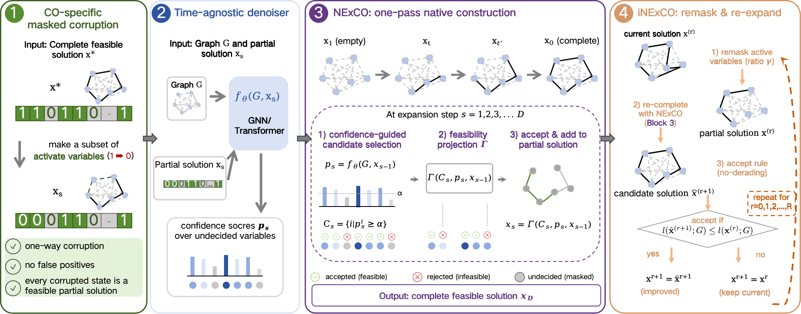

# NExCO: Native solution expansion for diffusion-based combinatorial optimization

Official implementation of ICLR 2026 paper ''[NExCO: Native solution expansion for diffusion-based combinatorial optimization](https://openreview.net/forum?id=084SvT55yk)''.  The code supports three routing and graph optimization benchmarks:

- Traveling Salesman Problem (TSP)
- Capacitated Vehicle Routing Problem (CVRP)
- Maximum Independent Set (MIS)

<p align="center">
  
</p>

## Repository Structure

```text
NExCO-main/
├── train.py                         # Main training and evaluation entry
├── diffusion/
│   ├── co_datasets/                 # TSP, CVRP, and MIS dataset loaders
│   ├── consistency/                 # Task-specific consistency trainers/inference
│   ├── models/                      # GNN and Transformer backbones
│   └── utils/                       # Schedulers, decoders, local search helpers
├── data/
│   ├── tsp_test/                    # TSP evaluation files
│   └── test_dataset/cvrp/           # CVRP evaluation files
├── ckpts/                           # Pretrained checkpoints
└── assets/                          # Figures used in this README
```

## Installation

Create the conda environment from the provided `environment.yml`:

```bash
conda env create -f environment.yml
conda activate nexco
```

TSP experiments require compiling the Cython heatmap-merging extension:

```bash
cd /path/to/NExCO-main
cd diffusion/utils/cython_merge
python setup.py build_ext --inplace
```

This repository also includes CVRP local-search code. If the prebuilt artifacts do not match your platform, rebuild them:

```bash
cd /path/to/NExCO-main
cd diffusion/utils/local_search/c_classic
make
```

## Pretrained Checkpoints
Please download the pretrained model checkpoints of NExCO from [Google Drive](https://drive.google.com/drive/folders/1rJseX3_htz0MFmM0R0E9NWVCz0ePflIs?usp=drive_link).

## Quick Start

Run all commands from the repository root:

```bash
cd NExCO-main
```

### Evaluate TSP

```bash
bash ../train_scripts/v000_baseline/test_tsp100.sh
bash ../train_scripts/v000_baseline/test_tsp500.sh
bash ../train_scripts/v000_baseline/test_tsp1000.sh
```

Or run a single command manually:

```bash
python train.py \
  --task tsp \
  --do_test \
  --storage_path ./ \
  --test_split data/tsp_test/tsp100_concorde_7.75585.txt \
  --ckpt_path ckpts/tsp100.ckpt \
  --consistency \
  --resume_weight_only \
  --parallel_sampling 1 \
  --sequential_sampling 1 \
  --rewrite \
  --rewrite_steps 5 \
  --rewrite_iterations 0 \
  --rewrite_ratio 0.1 \
  --m1 0.9 \
  --m2 0.7 \
  --two_opt_iterations 5000 \
  --offline
```

### Evaluate CVRP

```bash
bash ../train_scripts/v000_baseline/test_cvrp50.sh
bash ../train_scripts/v000_baseline/test_cvrp100.sh
bash ../train_scripts/v000_baseline/test_cvrp200.sh
```

Example manual command:

```bash
python train.py \
  --task cvrp \
  --do_test \
  --storage_path ./ \
  --test_split data/test_dataset/cvrp/cvrp100_hgs-20s_15.563.txt \
  --ckpt_path ckpts/cvrp100.ckpt \
  --consistency \
  --resume_weight_only \
  --parallel_sampling 1 \
  --sequential_sampling 1 \
  --rewrite \
  --rewrite_steps 1 \
  --rewrite_iterations 5 \
  --rewrite_ratio 0.4 \
  --m1 0.4 \
  --m2 0.5 \
  --two_opt_iterations 1 \
  --offline
```

### Evaluate MIS

```bash
bash ../train_scripts/v000_baseline/test_miser.sh
bash ../train_scripts/v000_baseline/test_misrb.sh
```

## Training

Training scripts are provided for each task and problem size:

```bash
# TSP
bash ../train_scripts/v000_baseline/train_tsp100.sh
bash ../train_scripts/v000_baseline/train_tsp500.sh
bash ../train_scripts/v000_baseline/train_tsp1000.sh

# CVRP
bash ../train_scripts/v000_baseline/train_cvrp50.sh
bash ../train_scripts/v000_baseline/train_cvrp100.sh
bash ../train_scripts/v000_baseline/train_cvrp200.sh

# MIS
bash ../train_scripts/v000_baseline/train_er.sh
bash ../train_scripts/v000_baseline/train_misrb.sh
bash ../train_scripts/v000_baseline/train_misrb_large.sh
```

Server launch scripts are in `../train_scripts/v000_baseline/`. They run without SLURM and write logs and metrics to `../outputs/v000_baseline/<run>/`. Set `CUDA_VISIBLE_DEVICES` to select GPUs. See the repository root README for experiment management and server environment requirements.

## Citation

If this repository is useful for your research, please cite the corresponding paper. 
```
@inproceedings{wang2026nexco,
  title={Nexco: Native solution expansion for diffusion-based combinatorial optimization},
  author={Wang, Yu and Li, Yang and Ma, Jiale and Yan, Junchi and Chang, Yi},
  booktitle={The Fourteenth International Conference on Learning Representations},
  year={2026}
}
```

## Acknowledgements

The environment setup follows [T2TCO](https://github.com/Thinklab-SJTU/T2TCO).
